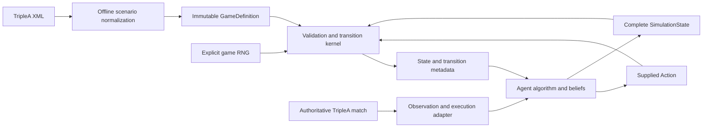
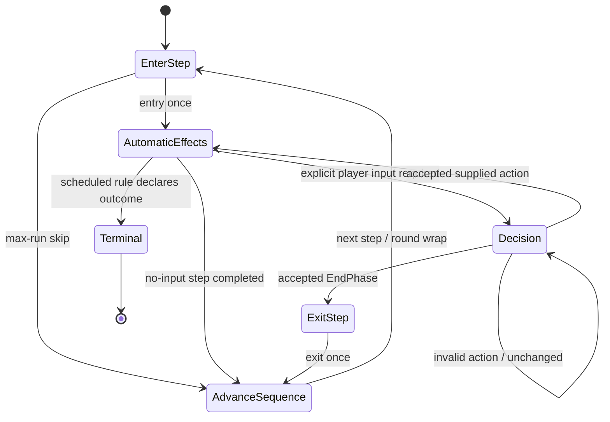
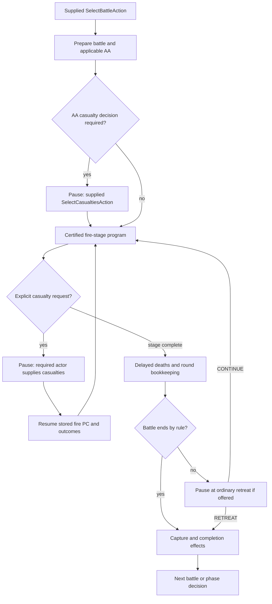
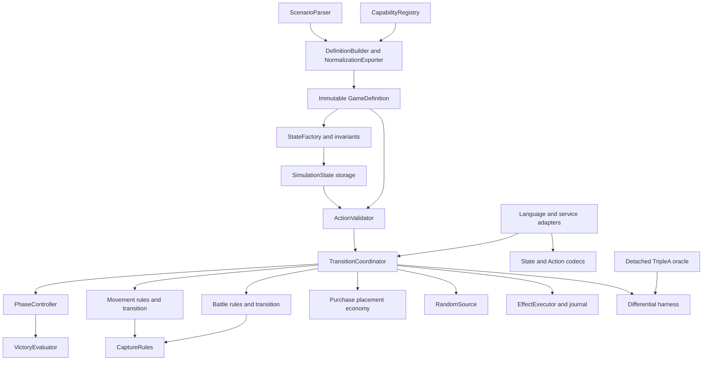

# Forward Model Implementation Specification

## 1. Purpose, authority and delivery contract

This specification defines an algorithm-independent, standalone environment-dynamics component. It is an engineering design, not an implementation or a second rule-extraction report. The semantic authority is [forward-model-rule-model.md](forward-model-rule-model.md), especially its §7 rule traces, §10 profiles, §11 detection requirements, §12 reuse evidence, §13 unresolved rules and revision-pinned source index. When this specification describes storage or control flow, it proposes an implementation; it does not establish previously unresolved TripleA behavior.

Evidence baseline: TripleA commit `2a8b4401d9a6442636fb1d90bf5659b15fa46343`; Capture the Flag map commit `8f5dd75ca3014713a3743b4904b9d5af76a73d26`; `map/games/capture_the_flag.xml` SHA-256 `23365e3e2a6f63ec0b76102ea773bd460acb92b890f36758de318c5267a169b0`. Source symbols below refer to that revision and the rule model's source index. Updating engine versions requires normalization, semantic and oracle recertification.

The component supplies game dynamics to planning, tree search, model-based RL, PPO/environment interaction, learned policies/value functions, hybrid agents and controlled evaluation. It contains no tree nodes, UCT/PUCT, rollout policy, backpropagation, search statistics, exploration, pruning or algorithm-specific reward. Capture the Flag (CTF) is the first complete conformance scenario. Passing its suite does not certify every TripleA option or map.

Build the implementation according to this document only after the unresolved gates named below are resolved for the configurations being admitted. Deliverables from implementation should include a versioned rule profile, normalized scenario package, kernel, language adapters, offline oracle adapter and conformance suite. This document creates none of those components.

## 2. Core contract and responsibility boundaries

```text
validate(definition, state, action) -> ValidationResult
transition(definition, state, action, rng_state) -> TransitionResult
```

`SimulationState` is the entire world. It may be observed, reconstructed, hypothetical or sampled from an agent's belief. A valid state need not be historically reachable from the XML initial setup. It must supply all history/transients needed at its claimed decision point. Neither operation may fill missing data from the authoritative match, the XML's initial board, a GUI or an external client setting.

| Component | Responsibility | Permitted inputs |
|---|---|---|
| Agent | Generates and represents candidate actions; chooses which to consider; pruning, search, planning, policies, values, learning, beliefs and sampling | Its observations, beliefs and immutable definition facts |
| Forward model | Interprets supplied actions, validates rules, applies deterministic/chance/automatic effects, maintains lifecycle and evaluates terminal rules | Definition, supplied state, action; explicit game RNG for transition |
| TripleA authoritative engine | Executes the actual match on true state | Authoritative engine state and actual match inputs |
| Observation/live adapter | Imports/exports at an explicitly requested testbench boundary, including the live state exporter, chance recorder and agent protocol v2 (§23.1–23.2); does not participate in hypothetical transitions | The live interface according to its observation permissions |
| Agent-side ActionToolkit (optional) | Candidate generation and action masks that agents may use, replace or ignore (§23.3); agent code, not model semantics | Kernel public API only: definition facts, read-only state views, `validate`/`validate_batch` |
| Offline oracle | Supplies development expectations using detached TripleA data | The same explicit hypothetical inputs as the model |

There is no `legal_actions`, `generate_actions`, candidate enumeration, action-template generation, pruning or policy helper in the model. A pending decision reports required input facts, not a list of generated choices. An agent may submit an invalid action; validation rejects it using its hypothetical world. Opponent and null-player decisions are also externally supplied Actions. The caller's scheduler determines which agent supplies the required actor's Action. Optional, shared candidate generation lives in the agent-side ActionToolkit (§23.3), outside the kernel; the kernel never depends on it.



There must be no runtime dependency from the kernel to `Adapter` or `Live`. Normalization and oracle modules may depend on TripleA; the production kernel must have no live-session capability.

## 3. Supported profile and certification boundaries

| Category | Implementation obligation |
|---|---|
| REQUIRED_V1 | Generic topology/unit/phase definitions; land/air movement; normal combat, blitz, conventional artillery support, classic AA and admitted Low Luck; treasury bombing; purchase, ordinary land placement/basic resources/economy; capture, ownership/liberation/capital effects; configured victory-city terminal checks |
| PLANNED_V2 | Naval movement/combat/purchase/placement; transports, cargo and loading/unloading (including activated land/air transport); carriers; amphibious assaults; submarines/destroyer special interactions; naval bombardment; associated canals/naval economy/dependencies |
| OPTIONAL_LATER | All optional mechanics listed in rule-model §10: advanced support/AA/targeting, unit-damage raids/repair, technologies, triggers/politics, scrambling/escorts/interceptors, special economics, effects/fuel/restrictions, nonzero bids and alternative victory algorithms |
| UNSUPPORTED | Arbitrary unregistered delegates/loaders; live edit/UI/network actions; internal action generation/policies; silent approximation or live-state completion |

V1 does not implement V2. Retain land/water topology and inert capability metadata so V2 can be added. CTF's unused naval declarations and compatibility costs do not by themselves activate naval execution. Active starting/purchasable naval units, cargo, carrier landing or similar deferred semantics cause explicit refusal.

Implement configuration combinations through a versioned capability registry, not a test for the map's name or XML hash. CTF's effective WW2V2 bundle is the first certification target. Other maps using admitted combinations need only XML changes, with no kernel modification. A REQUIRED_V1 mechanic with an unresolved variant is an implementation obligation, but that variant cannot return `SUPPORTED` until certified. Initial non-PU resource paths, multi-hit land/air cases, casualty identity normalization, simultaneous victory and legal purchase protocol remain gates from rule-model §13. Scope does not authorize guessing.

## 4. Scenario ingestion and normalization

Use three representations with one-way production dependencies:

1. **RawScenario:** XML syntax tree, source spans, original names/options/properties, delegate class strings, attachment declarations and initial setup. Preserve unknown fields. Apply safe XML processing; prohibit external entity/network resolution.
2. **NormalizedScenario:** typed effective values after pinned parser aliases, shorthand expansion, defaults, initialization-derived configuration and overrides. Every effective value carries provenance and activation evidence. Preserve rejected/inert declarations for diagnostics.
3. **GameDefinition:** deeply immutable executable configuration plus initial-setup recipe, profile certificate and derived tables. No live `GameData`, mutable attachment or delegate reference may escape into it.

A Java normalization utility reusing the pinned `GameParser`, `XmlGameElementMapper`, `LegacyPropertyMapper` and relevant attachment/default logic is the recommended first route. Its output is a portable normalized package; agents never parse TripleA XML. Do not silently replace parser behavior with a generic XML library's interpretation. Parser reuse alone does not perform complete feature detection or safely reproduce initialization.

Configuration normalization and initial-state construction are separate. Effects such as frontier adjustments, expanded factory/AA/support capabilities and phase interpretation belong to the definition. Starting units/resources/original-owner assignment and zero-bid skips belong to the setup recipe. Phase-entry effects belong to transitions. Never run initial setup logic over a caller's arbitrary midgame snapshot.

The builder must resolve and record the rule-model §5 cases, including missing dice sides, unit defaults/sentinels, null owner, factory/AA/artillery expansion, legacy property mapping, relationship defaults, original factory ownership, initialization overrides and step-property/name fallbacks. Legacy engine names that genuinely change initialization must be resolved here with evidence; the runtime kernel must not test for `battleship`, `infantry`, `Flag`, `Base` or faction names.

`build_definition(raw, profile, overrides)` returns either `(definition, support_report)` or a typed load error. Overrides are explicit immutable inputs, included in the fingerprint; external preferences are never consulted during simulation. Cache normalized packages by raw-input digest, pinned engine, normalizer version, overrides and profile version.

## 5. Exact immutable GameDefinition schema

### 5.1 Types and provenance convention

The following is a language-neutral logical schema. All fields listed are required unless marked `?`; empty collections are explicit. Use bounded checked arithmetic, reject overflow and reject unresolved references. Internal identifiers are dense `u32` indices scoped to one definition: `TerritoryId`, `PlayerId`, `AllianceId`, `UnitTypeId`, `ResourceId`, `ProductionRuleId`, `SupportRuleId`, `StepId`. `OwnerId = PlayerId | NULL_PLAYER`; it is never inferred from location. `UnitId` and `BattleId` are stable `u64` state identities. `Count = u32`; economic `Amount = i64` with nonnegative balances/cost quantities unless a specifically certified rule says otherwise. `ExactMovement` is a signed checked integer in definition-wide `movement_scale`; V1 admits integral costs (`scale=1`) initially and retains exact rational compatibility for later profiles. Do not use floating point for movement legality.

For each table below, `X` means pinned XML/parser input; `D` means pinned default/derived normalization; `S` means this implementation schema/profile; `P` marks safe precomputation. Sources identify the relevant rule-model section and engine symbol. A source span is `{file_digest, element_path, line?, column?}`. An effective value's provenance is `{source_spans[], original_key?, canonical_key, origin: XML|DEFAULT|SHORTHAND|INITIALIZATION|OVERRIDE, derivation_id?, dependencies[]}`. Store provenance outside hot loops, keyed by canonical field path; retain it in the package.

### 5.2 Root schema

| Field | Type | Meaning/source | Precompute |
|---|---|---|---|
| `schema_version` | u32 | S; compatibility of this normalized format | Yes |
| `engine_revision`, `normalizer_version`, `profile_id`, `profile_version` | string | S; exact semantic/certification baseline | Yes |
| `definition_digest` | 32-byte digest | D; hash canonical effective rules, semantic entity ordering, setup, overrides and versions; excludes diagnostic text | Yes |
| `source_digests` | map<string, digest> | X; all included XML inputs | Yes |
| `entities` | EntityNames | X/D; ID↔canonical XML name tables for every ID domain; null owner separate | Yes |
| `territories`, `players`, `alliances`, `unit_types`, `resources`, `production_rules`, `support_rules`, `steps` | immutable arrays of records below | X/D; complete normalized definitions | Yes |
| `relationship_types`, `relationships` | records; matrix<RelationshipTypeId> | X/D; static relationship semantics, not ally booleans only | Yes |
| `movement_rules`, `combat_rules`, `economy_rules`, `capture_rules`, `placement_rules`, `victory_rules` | typed records below | X/D; effective rule selectors/parameters | Yes |
| `step_order` | array<StepId> | X; `<sequence>` order, not player-name order | Yes |
| `initial_setup` | SetupRecipe | X/D; explicit starting state facts, once-only initialization recipe | Yes |
| `effective_properties` | map<CanonicalPropertyKey, TypedValue> | X/D; recognized gameplay property values including default sources; no runtime arbitrary interpretation | Yes |
| `capability_manifest` | array<CapabilityUse> | D; active/inert/unknown evidence from detection | Yes |
| `certificate` | SupportCertificate | S/D; registry version, admitted combinations and certified semantic settings | Yes |
| `provenance` | map<FieldPath, Provenance> | X/D; diagnostic explanation | Yes |
| `static_tables` | StaticTables | D; CSR adjacency, relationship masks, rule/frontier lookups, geometry lower bounds | Yes |

An immutable definition can be shared across simulations. Do not store current ownership, balances, turn-dependent support allocations or mutable rule values here.

### 5.3 Map, actors and resources

| Record.field | Type | Meaning and source | P |
|---|---|---|---|
| Territory.`id`, `name` | TerritoryId, string | X; `<map><territory>` identity | Yes |
| Territory.`domain` | LAND\|WATER | X/D; water flag/parser default (§7.3/7.6); retained in V1 | Yes |
| Territory.`neighbors` | sorted set<TerritoryId> | X/D; undirected `<connection>` graph, duplicates collapsed by parser | Yes |
| Territory.`entry_cost` | ExactMovement | D; default 1; active modified-cost effects rejected unless admitted | Yes |
| Territory.`impassable` | bool | X/D; territory attachment and applicable movement properties | Yes |
| Territory.`production` | Amount | X/D; territory attachment production (§7.22/7.23), distinct from starting resources | Yes |
| Territory.`income` | map<ResourceId, Amount> | X/D; normalized admitted basic resource income contributions; exact non-PU path certification gate | Yes |
| Territory.`victory_value` | i32 | X/D; victoryCity normalization, not inferred from capital/name/production | Yes |
| Territory.`capital_for` | set<PlayerId> | X/D; territory attachment capital references | Yes |
| Territory.`original_owner` | OwnerId | X/D; starting ownership/original metadata; runtime ownership separate | Yes |
| Territory.`effects`, `extension_metadata` | array<CapabilityUse>, typed inert values | X/D; preserve unsupported terrain/canal/etc evidence; no silent execution | Yes |
| Player.`id`, `name` | PlayerId, string | X; player list; identity, no behavior dispatch | Yes |
| Player.`production_frontier` | set<ProductionRuleId> | X/D; frontier assignments including initialization changes (§7.21) | Yes |
| Player.`capital_collection_threshold`, `capital_purchase_threshold` | Count | X/D; player attachment/default capital predicates (§7.20) | Yes |
| Player.`initial_enabled`, `initial_optional` | bool, bool | X/D; setup player flags; effective disabled-assets initialization | Yes |
| Alliance.`id`, `name`, `members` | AllianceId, string, ordered array<PlayerId> | X/D; alliances, preserve semantic iteration order where observable | Yes |
| RelationshipType.`id`, `archetype`, `permissions` | ID, enum, typed flags | X/D; `RelationshipTypeAttachment`: movement/landing/cooperation/war/liberation as traced; unknown flags rejected | Yes |
| Resource.`id`, `name` | ResourceId, string | X; resource list | Yes |
| Resource.`roles` | set<TREASURY\|PURCHASE_INPUT\|INCOME_OUTPUT> | D; roles resolved from admitted engine paths, not literal names in kernel | Yes |

Keep both alliances and relationship semantics: membership is not a sufficient substitute for all permission tests. Store parser-established order whenever engine iteration is observable. Do not sort alliances for convenience until simultaneous-victory semantics are resolved.

### 5.4 Units, support, AA and bombing

| Record.field | Type | Meaning and source | P |
|---|---|---|---|
| UnitType.`id`, `name`, `domain` | UnitTypeId, string, LAND\|AIR\|SEA | X/D; unit definition/UnitAttachment flags (§5/7.2) | Yes |
| UnitType.`movement`, `attack`, `defense` | ExactMovement, i32, i32 | X/D; unit attachment movement/attack/defense; omitted defaults 0 | Yes |
| UnitType.`attack_rolls`, `defense_rolls`, `hit_points` | Count, Count, Count | X/D; attachment, defaults 1; capability combinations certified | Yes |
| UnitType.`capabilities` | set<CapabilityId> | X/D; expanded blitz, infrastructure, producer, AA, raid, etc; separate capability evidence from names | Yes |
| UnitType.`producer` | ProducerSpec? | X/D; factory shorthand/isUnitProducer and explicit options | Yes |
| UnitType.`aa` | array<AaSpec> | X/D; classic AA battery/exposure parameters | Yes |
| UnitType.`bombing` | BombingSpec? | X/D; permitted raid ability/strength/damage properties | Yes |
| UnitType.`capture_policy` | typed enum/flags | X/D; ordinary capturable infrastructure vs fighting unit; advanced conversion rejected | Yes |
| UnitType.`max_built_per_player` | i32 sentinel or Count | X/D; attachment sentinel normalized to UNLIMITED or finite limit | Yes |
| UnitType.`support_rule_ids` | array<SupportRuleId> | X/D; shorthand and explicit support attachments | Yes |
| UnitType.`deferred_metadata` | typed map | X/D; transport/carrier costs/capacity, sub/bombard etc retained with activation status; V1 cannot execute | Yes |
| SupportRule.`id`, `providers`, `recipients`, `owners` | ID, sets<UnitTypeId>, player filter | X/D; UnitSupportAttachment/shorthand (§7.12) | Yes |
| SupportRule.`side`, `strength_bonus`, `roll_bonus`, `capacity`, `bonus_group`, `priority` | ATTACK\|DEFENSE\|BOTH, i32, i32, Count, string, normalized ordering key | X/D; normalized support grouping/consumption order; V1 conventional rule combinations only | Static eligibility; allocation dynamic |
| AaSpec.`exposures`, `targets` | set<COMBAT\|BOMBING\|FLYOVER>, set<UnitTypeId> | X/D; AA attachment expansion; omitted targets air (§7.15) | Yes |
| AaSpec.`strength`, `dice_sides?`, `shots_policy`, `max_rounds`, `damage_mode` | i32, Count?, typed enum, Count, KILL\|HIT | X/D; exact classic admitted settings/default first round; advanced values trigger rejection | Yes |
| BombingSpec.`targets`, `damage_dice`, `damage_bonus`, `cap_policy` | target predicate ID, Count, i32, typed enum | X/D; effective raid options/property selectors (§7.18); unsupported choose-best/unit-damage modes rejected | Yes |
| ProducerSpec.`can_produce`, `capacity_policy`, `construction_type`, `construction_limits` | bool, enum, string?, typed limits | X/D; originalFactory/production producer and construction options (§7.22) | Static policy only |

Every selector is a closed enum with a registered semantics handler. Never add a string callback that silently invokes untrusted XML classes. Preserve unused unsupported unit definitions as inert metadata only after detection proves they cannot be activated by the scenario; supplied states/actions must pass the same activation guard.

### 5.5 Economic, phase and global rules

| Record.field | Type | Meaning and source | P |
|---|---|---|---|
| ProductionRule.`id`, `name`, `costs`, `results` | ID, string, map<ResourceId,Amount>, array<ProductionOutput> | X; `<productionRule><cost>/<result>`; output `{kind: UNIT\|RESOURCE, target_id, quantity}`; only certified output paths admitted | Yes |
| Step.`id`, `name`, `delegate_kind`, `actor` | StepId, string, enum, PlayerId? | X/D; sequence and mapper/delegate classes (§7.1) | Yes |
| Step.`max_runs`, `run_count_scope` | Count? (null unlimited), enum | X/D; sequence/default count semantics | Yes |
| Step.`phase_kind`, `move_mode`, `lifecycle_policy` | enum, COMBAT\|NONCOMBAT\|NONE, LifecyclePolicy | X/D; explicit step properties then verified name fallback/`GameStep`; never hardcode names in kernel | Yes |
| Step.`income_timing`, `reset_policy`, `victory_check` | enum, ResetPolicy, bool | X/D; entry/exit semantics of admitted delegates | Yes |
| LifecyclePolicy.`entry_ops`, `exit_ops`, `automatic_ops` | ordered array<RegisteredEffectId> | D; once-only traced operations and zero-input delegate behavior; no arbitrary script execution | Yes |
| MovementRules.`movement_scale`, `neutral_policy`, `blitz_policy`, `air_landing_policy` | u32, typed rule records | X/D; route/neutral/flyover/blitz/air property bundle (§7.2–7.5) | Static predicates |
| CombatRules.`dice_sides`, `roll_mode`, `aa_roll_mode`, `max_rounds`, `stalemate_policy`, `casualty_policy`, `retreat_policy` | Count, ORDINARY\|LOW_LUCK, enum, Count?, enum, enum, enum | X/D; Properties/Battle/MustFightBattle/GameStep (§7.10–7.15), d6 default | Static thresholds |
| CombatRules.`stage_programs` | map<BattleKind, RegisteredProgramId> | D/S; certified normal-land/air and treasury-raid stage schedules | Yes |
| EconomyRules.`treasury_resource`, `income_multiplier`, `raid_multiplier`, `raid_caps`, `purchase_gate` | ResourceId?, exact integer/rational parameters, typed records | X/D; admitted resource/capital/raid properties (§7.18/7.20/7.21/7.23) | Static parameters |
| CaptureRules.`capture_policy`, `liberation_policy`, `capital_treasury_policy` | registered typed records | X/D; ownership/helper/property semantics (§7.19/7.20) | Static predicates |
| PlacementRules.`producer_policy`, `captured_producer_policy`, `new_producer_policy`, `unplaced_policy`, `construction_limits` | enums/typed records | X/D; AbstractPlaceDelegate/PlaceDelegate/properties (§7.22) | Static type lookups |
| VictoryRules.`kind`, `checks`, `alliance_thresholds`, `iteration_order` | VC_THRESHOLD, array<StepId>, map<AllianceId,Amount>, ordered array<AllianceId> | X/D; EndRoundDelegate/Properties (§7.24); simultaneous result unresolved | Static membership |
| SetupRecipe.`owners`, `units`, `balances`, `originals`, `step_initial_counts`, `initial_round`, `initial_cursor` | arrays/maps matching state facts | X/D; initialize once from normalized setup and admitted initializer effects | Yes |
| CapabilityUse.`feature_id`, `status`, `activation_paths`, `provenance`, `required_profile` | strings/enums/evidence arrays | D; active/inert/unknown support detection | Yes |
| SupportCertificate.`registry_version`, `admitted_combinations`, `restrictions`, `settings_digest` | strings, set, typed restrictions, digest | S/D; loader contract | Yes |

Global typed rule records include **only** canonical fields enumerated by the registry's supported property manifest. Each manifest entry must specify exact type, absence default, source symbol, permitted values, dependencies, initialization effects and consuming handlers. The manifest is an implementation deliverable; the rule model explicitly does not contain a complete inventory. Until completed, unknown gameplay-capable fields produce `UNCERTIFIED_CONFIGURATION`; `effective_properties` is not a permissive catch-all. This is an unresolved completeness gate, not permission to omit settings.

### 5.6 Core policy record contracts and field completeness

The following leaf records make the core selectors concrete. All values are normalization outputs, never caller-chosen rule changes. Source/default evidence follows the referenced rule-model trace; an exporter must distinguish absent defaults from explicit values. No unstated default is defined here.

| Leaf record | Fields and types | Source/meaning/precomputation |
|---|---|---|
| `NeutralPolicy` | `entry_allowed: bool`, `air_flyover_allowed: bool`, `blitz_allowed: bool`, `charge_resource: ResourceId?`, `charge_amount: Amount`, `charge_scope: registered enum` | X/D §7.3/7.4; exact neutral permissions/charging bundle. Static parameters; charged territory history is state |
| `BlitzPolicy` | `enabled: bool`, `hostile_infrastructure_blocks: bool`, `fresh_capture_passage: registered enum` | X/D §7.4; WW2V2 and other admitted bundles resolved before execution. Static |
| `AirLandingPolicy` | `require_allied_land: bool`, `allow_fresh_capture: bool`, `neutral_landing: registered enum`, `feasibility_program: RegisteredProgramId`, `carrier_enabled: bool` | X/D §7.5; land feasibility and cleanup; active carrier solution rejects V1. Static program, dynamic evaluation |
| `RaidCaps` | `per_bomber: NONE\|TERRITORY_PRODUCTION`, `aggregate_per_turn: registered enum`, `cash_floor: Amount`, `damage_mode: TREASURY` | X/D §7.18; effective cap and cash semantics; aggregate losses state. Non-treasury mode rejects V1 |
| `ResetPolicy` | `movement_scope: registered enum`, `combat_flags_scope: registered enum`, `capture_history_scope: registered enum`, `raid_history_scope: registered enum` | X/D §7.1/7.2/7.18; scope tags map to certified lifecycle effects, not universal current-player reset. Static |
| `CapturePolicy` | `ground_survivor_required: bool`, `infrastructure_transfer: registered enum`, `neutral_capture: registered enum` | X/D §7.19; movement/battle capture qualification; pure predicate with state |
| `LiberationPolicy` | `program_id: RegisteredProgramId`, `original_capital_requirement: registered enum` | X/D §7.19/7.20; preserve full original-owner/capital predicate; static handler, state-dependent result |
| `CapitalTreasuryPolicy` | `resource: ResourceId?`, `capture_disposition: TRANSFER\|DESTROY\|registered admitted enum`, `original_owner_required: bool`, `threshold_program: RegisteredProgramId` | X/D §7.20; current/original capital and treasury consequences; static parameters |
| `ConstructionLimits` | `type_key: string`, `per_territory: Count?`, `per_turn: Count?`, `per_player: Count?` | X/D §7.22; normalized unlimited is null; advanced consumes/requires/conversion flags separately rejected |

If a supported engine property needs another leaf field, add it to a versioned schema with provenance and tests before admitting that combination. Registered enums/program IDs are drawn from the profile manifest and are closed; they are not arbitrary user plugins. They avoid falsely encoding complex source predicates as one generic boolean. Semantic selector names in these tables are model schema names; the provenance maps them to actual TripleA canonical property keys.

**UNRESOLVED-SCHEMA-MANIFEST:** the complete canonical property inventory, registered scope/program alternatives and every default value are not established by the existing report. These are explicitly incomplete leaf-definition gates. Resolve them from its identified source locations and offline exporter results, rather than claiming this document already enumerates every TripleA option. The outer records, ownership, field categories and transport format contract above are fixed engineering recommendations; the manifest supplies exact admitted leaf values. Shipping with free-form or ignored placeholders is prohibited.

### 5.7 StaticTables and precomputation

Store CSR adjacency with neighbor sets, unit-domain masks, actor/relationship permission masks, frontier cost/result vectors, support eligibility, capital/victory membership and registered phase programs. Optional all-pairs geometric shortest distances are lower bounds only: dynamic blockers, fresh captures, landing restrictions and actual routes still require state-aware validation. Do not cache legal actions. Factory capacities dependent on current ownership/history and support allocations dependent on surviving units are not definition constants.

## 6. SimulationState schema and state construction

### 6.1 Root and entity state

`SimulationState` is logically mutable and externally complete; the primary `transition` API returns a fresh result without modifying the input. Mutable internal layouts are permitted. `E` = ESSENTIAL, `C` = DERIVABLE/CACHED, `L` = DEBUG/LOGGING ONLY. Required E fields are serialized. Fields that are reconstructible from the definition need not be duplicated.

| Field | Type/class | Future consumer and requirements |
|---|---|---|
| `schema_version`, `definition_digest` | u32, digest; E | Deserialization, configuration compatibility; no cross-definition IDs |
| `round` | u32; E | Sequence/round accounting; not inferred from log length |
| `cursor` | PhaseCursor; E | Resume exact step/subphase/lifecycle without duplicate effects |
| `step_run_counts` | array<u32>; E | Max-run and startup-step skipping |
| `decision` | DecisionContext?; E | Expected actor/input type; terminal state has none |
| `territory_owner` | array<OwnerId>; E | Movement, combat, income, capture, victory |
| `territory_original_owner` | array<OwnerId>; E | Liberation/capital/infrastructure semantics; explicit hypothesis may differ from setup |
| `units` | map<UnitId,UnitState>; E | Complete extant and purchased/unplaced pieces |
| `balances` | matrix<PlayerId,ResourceId,Amount>; E | Purchases, income, raids and capital transfers |
| `history` | TurnHistory; E | Capture/blitz/fought, producer/phase and per-turn limits |
| `placement` | PlacementContext?; E | Entry producer snapshots and cumulative batch consumption |
| `battles` | map<BattleId,BattleState>; E | Pending/active battle execution and decision resumption |
| `active_battle` | BattleId?; E | Prevent switching unfinished battle |
| `continuation` | AutomaticContinuation?; E | Interrupted movement/phase/battle effects awaiting input |
| `terminal` | TerminalOutcome?; E | Prevent transitions after scheduled game end |
| `next_unit_id`, `next_battle_id`, `next_decision_id` | u64; E | Deterministic fresh identity generation, no random UUIDs |
| `semantic_revision` | u64; C | Cache invalidation; portable value may be rebuilt, not a game rule |
| `territory_unit_index`, `owner_counts`, `resource_totals`, `state_hash` | arrays/maps/hash; C | Fast queries; rebuild and verify, never independent authority |
| `event_history`, `human_labels`, `profiling_counters` | optional records; L | Diagnostics only; removal cannot change dynamics |

`PhaseCursor = {step_id: StepId, sequence_index: u32, lifecycle: NOT_ENTERED|ENTERED|EXIT_PENDING, subphase: registered enum, entry_effect_pc: u32, exit_effect_pc: u32}`. PCs record effects already committed. Current player derives from the step; the next decision actor may instead be a defender or null player. Reject contradictory duplicated current-player fields. Run-count increment timing must match the certified phase program, not an arbitrary serialization convention.

`UnitState = {id: UnitId, type: UnitTypeId, owner: OwnerId, original_owner: OwnerId, location: TerritoryId|HELD(PlayerId), movement_spent: ExactMovement, bonus_movement: ExactMovement, hits: Count, flags: UnitTurnFlags}`. All are E. `hits < hit_points` for living units; dead units are removed except explicitly staged waiting-to-die identities in battle state. V1 `UnitTurnFlags = {was_in_combat: bool}`; movement usage is recorded separately. `bonus_movement` is essential if present in the claimed state, but nonzero bonus-system activation is rejected until that optional feature is admitted. Future cargo/submerged/amphibious flags require a versioned extension; V1 rejects active use. Do not invent behavior for unknown flags. Held units have no board location and cannot move/fight. Unit identity survives moves, damage, capture and serialization. Type/owner/original-owner changes only follow a supported rule or caller-provided hypothesis.

### 6.2 Histories and placement

| Record.field | Type/class | Why essential or derived |
|---|---|---|
| TurnHistory.`scope_actor`, `scope_step`, `scope_round` | IDs/u32; E | Determines reset window, especially configurable/interleaved sequences |
| `conquered`, `blitzed`, `fought_territories` | sets<TerritoryId>; E | Blitz passage, landing, producer/capture/AA suppression; not inferable from owner alone |
| `capture_records` | ordered array<{territory, from, to, cause, step}>; E to extent rules consume; remainder L | Preserve original liberation/capital and capture transitions; trim only proven nonsemantic detail |
| `raid_loss_by_territory` | map<TerritoryId,Amount>; E | Aggregate per-turn raid caps |
| `aa_exposure` | map<exposure key, exposure status>; E | Prevent duplicate shots after continuation/split route; keys follow certified scope |
| `phase_start_units` | set<UnitId>; E where consumed | Entry-relative production/movement lifecycle facts |
| PlacementContext.`actor`, `entry_step`, `eligible_producers` | IDs; map<UnitId,ProducerSnapshot>; E | Starting producers and original/captured/new factory eligibility |
| ProducerSnapshot.`territory`, `owner`, `original_owner`, `capacity_basis`, `eligible` | typed values; E | Entry eligibility cannot be recreated from current board after placements |
| PlacementContext.`usage` | map<producer/bucket key, Count>; E | Multiple PlaceActions share limits |
| PlacementContext.`construction_usage` | map<territory/type key,Count>; E | Construction/placement limits across batches |
| `purchased_count_cache`, `remaining_capacity_cache` | maps; C | Derive from units, definition and placement usage |

Actual storage should retain the smallest semantic sufficient history. Before removing an E field as redundant, demonstrate reconstruction at arbitrary admitted midphase decision points, including hypothetical ownership changes. Original ownership is not synonymous with current ownership.

### 6.3 Battle and continuation state

`BattleKind = NORMAL | TREASURY_RAID | extension tag`. V1 supports normal land/air battles and treasury raids; `domain=LAND|WATER` is preserved, but active water battles reject under V1.

| BattleState.field | Type/class | Required continuation |
|---|---|---|
| `id`, `kind`, `site`, `domain`, `attacker`, `defender` | typed IDs/enums; E | Battle identity/context; null defender allowed |
| `status`, `program_id`, `pc`, `round` | PENDING\|ACTIVE\|COMPLETE, program ID, u32, u32; E | Exact certified stage and next effects |
| `attacking_units`, `defending_units` | ordered array<UnitId>; E | Participants; exclude infrastructure from fire as rules require |
| `attacking_origins` | map<UnitId,TerritoryId>; E | Retreat eligibility; actual origins, not inferred adjacent nodes |
| `attack_history`, `retreat_origins` | certified origin/history records; E | Unit-group/origin distinctions and air-only-origin exclusions |
| `dependencies` | array<BattleDependency>; E | Raid-before-normal ordering; V1 dependency kinds only; V2 tags reject |
| `waiting_to_die`, `removed_this_stage`, `damage_this_stage` | unit-ID sets/maps; E while stage active | Delayed return fire and casualty effects |
| `pending_hit_batches` | ordered array<HitBatch>; E | Hits already rolled, selection actor, eligible target identities, damage restrictions |
| `support_assignment` | stage-local record; C if recomputable before draws, E after outcomes depend on it | Prevent reinterpretation of a recorded chance result |
| `raid_target`, `raid_damage_results`, `aa_context` | typed records?; E where active | Raid/AA outcomes and caps; never reroll on resume |
| `completion_effect_pc` | u32; E | Capture/bookkeeping exactly once |
| `dice_history`, `display_summary` | records; L if no rule consumes | Optional explanation; outcomes necessary for pending decisions are E above |

`HitBatch = {id: u64, source_stage, selecting_actor: OwnerId, hit_count: Count, eligible_units: ordered array<UnitId>, permitted_damage: typed constraints, return_fire_policy, outcomes: ChanceSummary}`. This is a rule-defined target set, not generated casualty Actions. Exact identity-equivalence normalization is unresolved; the serializer/action validator must not freeze an arbitrary policy before oracle certification.

`DecisionContext = {id: u64, actor: OwnerId, kind: PURCHASE|MOVE|BATTLE_SELECTION|CASUALTIES|RETREAT|RAID_TARGET|PLACE|END_PHASE|registered extension, step_id, battle_id?, hit_batch_id?, facts: typed context}`. `facts` contains relevant totals, identities and provenance; no action list, ranked choices or proposed route. Phase contexts may accept several action kinds (e.g. MoveAction or EndPhaseAction) through a fixed protocol-kind set, without generating actions.

`AutomaticContinuation = {program_id, pc, step_id, battle_id?, committed_effects: typed flags, payload: MoveContinuation|PhaseContinuation|BattleContinuation}`. A move continuation contains the submitted unit IDs, route, move mode, operation stage, unresolved exposure, survivors and committed movement/capture/participant bookkeeping markers. This permits AA casualties to interrupt movement. The exact placement of markers relative to each engine change must come from the existing trace plus oracle tests; do not debit movement twice or replay already drawn AA. Do not suspend existing Java code by throwing exceptions unless its resumable continuation has been proven safe.

### 6.4 Construction, invariants and portable representation

Provide two distinct constructors: `create_initial_state(definition)` applies the setup recipe once; `create_state(definition, CompleteSnapshot)` installs exactly the supplied world and validates invariants. It never merges template units or injects default initial funds. Snapshot decision-point fields must be consistent with certified program PCs; missing origins/history/lifecycle fields return `INCOMPLETE_SIMULATION_STATE`.

Public snapshots describe settled decision points or terminal states. Internal automatic stages exist inside transition; checkpoint import of those stages is an optional versioned debug/oracle facility, not silently accepted as a normal state. An arbitrary hypothetical state may differ from the XML initial board, but may not activate unsupported features or omit necessary transients.

Portable encoding: versioned typed binary message schema with optional canonical JSON interchange for debugging; include explicit empty/null values, definition digest, E fields and sorted canonical maps. IDs are wire integers with declared domains, not pointers. A portable snapshot has no process handles or cached `GameData`. Encode wide integers losslessly in JSON (e.g. decimal strings in the JSON mapping). Reject unknown semantic fields/version mismatches; tolerate only explicitly nonsemantic extension metadata. Serialization roundtrip preserves all future behavior, not necessarily debug history or cache layout.

Internal encoding: structure-of-arrays units, dense territory/resource arrays, bitsets for histories, arena-backed battle/continuation records and index maps. Compact slots may move; UnitId must not. Caches are rebuilt after import and invalidated on affected mutation. No JSON parsing occurs per local simulation call.

## 7. Typed agent-supplied Actions

All Actions have `ActionHeader = {schema_version: u32, definition_digest, actor: OwnerId, decision_id: u64}`. The decision ID prevents applying an action to a stale decision; it is not a search-node identifier. The body is a closed tagged union, extended only with profile/version support. An action submitted by an opponent is structurally identical to one submitted by the current agent. Payload references identities in the supplied state.

| Action and payload | Actor/decision | Validation | Effects |
|---|---|---|---|
| `PurchaseAction {quantities: map<ProductionRuleId,Count>}` | Purchasing player; purchase phase | Actor, frontier membership, quantities, resources, build limits, capital/lifecycle gates; checked vector totals | Deduct costs; create deterministic held output identities/apply admitted resource outputs; remain at purchase decision until EndPhase |
| `MoveAction {units: ordered array<UnitId>, route: array<TerritoryId>, intent: NORMAL\|RAID, raid_target?: UnitId\|TerritoryId}` | Moving player; combat/noncombat move | Nonempty distinct owned movable units; start locations; explicit route including start; adjacency, entry domains, blockers, spend, blitz/neutral/landing feasibility, phase intent and raid eligibility | Apply certified movement stages, captures/AA exposure/participants/raid creation; pause for explicit AA casualty choice if needed |
| `SelectBattleAction {battle_id: BattleId}` | Step's battle actor; battle selection | Pending battle exists, dependency satisfied, no other active battle, actor/step match | Start selected battle; run automatic stages to first required decision or completion |
| `SelectCasualtiesAction {hit_batch_id: u64, killed: array<UnitId>, damage: map<UnitId,Count>}` | HitBatch selecting actor, often opponent/null defender | Batch match; targets, hit assignment, HP/capacity/return-fire/identity-normalization rules; no duplicates or overdamage | Commit selected casualties/damage; resume stored stage/outcomes without reroll |
| `RetreatAction {choice: CONTINUE\|RETREAT, destination?: TerritoryId}` | Attacker; ordinary retreat decision | Actual origin-derived predicate, participants, WW2V2 exclusions and destination legality; CONTINUE has no destination | Resume next round or retreat/remove participants and conclude as appropriate; attacking air's physical location follows traced semantics |
| `SelectRaidTargetAction {battle_id: BattleId, target: TerritoryId\|UnitId}` | Attacker; explicit target decision only where admitted rules require | Correct raid/context and supported treasury target path; no production-damage substitute | Bind target and continue AA/raid stages; may be unnecessary if MoveAction already binds a unique required target |
| `PlaceAction {units: array<UnitId>, territory: TerritoryId, producer_id?: UnitId}` | Placing player; placement decision | Held ownership, permitted outputs/domains, entry producer eligibility, original/current ownership, capacities/construction/batch limits | Move held units to board; debit placement usage; remain in placement phase |
| `EndPhaseAction {}` | Current step actor; ordinary phase decision | No pending child decision/unfinished battle, mandatory phase obligations and configured cleanup preconditions satisfied | Exit effects and sequence advancement; enter automatic steps until next decision or terminal |

Actor choice is never replaced by a built-in weakest-unit, preferred-target or retreat policy. If TripleA has a mandatory automatic consequence with no genuine discretion, execute it automatically; document the proof and oracle test. Do not treat its GUI default selection or AI policy as proof of no discretion. Casualty equivalence may make identities interchangeable but must be certified before automatically skipping a decision.

Producer selection is supplied only when the admitted engine semantics give a meaningful producer decision. If it is a deterministic engine allocation, resolve it with the certified allocation rule; reject inconsistent supplied IDs. This land-production distinction requires oracle verification; naval multiple-producer reallocation remains V2. A raid target field does not enable unsupported unit-damage raids.

| Event class | Origin | Representation |
|---|---|---|
| AGENT DECISION | External policy for required actor | Action, validated at a decision point |
| OPPONENT DECISION | External policy for another required actor | Same Action mechanism; no internal adversary policy |
| CHANCE EVENT | Registered stochastic stage | RNG request/outcome, not Action |
| AUTOMATIC TRANSITION | Registered game/lifecycle effect | State-machine operation; no agent action generation |

An externally configured research horizon stops the testbench, not the game's terminal state. Environment reset and belief replacement are constructors/adapters, not ordinary TripleA Actions.

## 8. Validation and error contract

Validation is pure, consumes no RNG and does not mutate state, semantic caches or definition. Read-only memoization is allowed only if observationally invisible and thread-safe. `ValidationResult = Valid | Invalid {code, field_path?, rule_id, message, facts?}`. Facts explain the failure; they do not include generated corrections or candidate actions.

Validation stages, in order:

1. Schema/digest/action tag and profile checks; reject unsupported mechanics before interpreting them.
2. State envelope/integrity check (trusted internal handles may carry a validated revision certificate; imports require full checks).
3. Decision token, actor, phase/subphase/lifecycle checks.
4. Identity/reference/quantity/route shape and checked arithmetic checks.
5. Static rules: frontier, unit capability, topology, domains, permitted target kinds and relationships.
6. Dynamic rules: ownership, spend/history, obstruction/blitz, hypothetical air landing feasibility, resources/limits, pending batch/retreat/dependency/placement contexts.
7. Commit preconditions: cannot end phase with unresolved mandatory decisions or active child continuation; verify registered rule combination.

`transition` repeats or safely shares validation through an internal nonpublic validation plan keyed by definition digest, full semantic revision and exact Action. It must not trust a caller's claimed `Valid`. Plans contain interpreted references/predicates, not generated actions. Invalid actions return the unchanged input state and unchanged RNG state.

| Error class/code examples | Meaning and failure behavior |
|---|---|
| `INVALID_ACTION`: ACTOR_MISMATCH, STALE_DECISION, WRONG_PHASE, UNKNOWN_ID, DUPLICATE_UNIT, BAD_ROUTE, INSUFFICIENT_MOVEMENT, BLOCKED_ROUTE, ILLEGAL_LANDING, INSUFFICIENT_RESOURCES, FRONTIER_MISMATCH, BAD_CASUALTIES, ILLEGAL_RETREAT, CAPACITY_EXCEEDED, PHASE_OBLIGATION | Legal rules are supported but supplied action violates them; recoverable rejection |
| `INCOMPLETE_SIMULATION_STATE` | Required history/origin/continuation data absent; no live-state completion |
| `INVALID_SIMULATION_STATE` | Contradictory identities, HP, cursor, references, ownership or lifecycle; reject import/call |
| `UNSUPPORTED_BY_PROFILE_V1` | Activated deferred capability; include feature, provenance and V2 reason |
| `UNCERTIFIED_CONFIGURATION` | Known REQUIRED_V1 combination still unresolved/unverified; refuse fidelity claim |
| `SCHEMA_MISMATCH`, `DEFINITION_MISMATCH` | Versions or definition identity differ |
| `RNG_TAPE_MISMATCH`, `RNG_EXHAUSTED` | Controlled RNG cannot satisfy exact request; transition fails atomically |
| `ENGINE_FAILURE`, `ARITHMETIC_OVERFLOW`, `AUTOMATIC_PROGRESS_FAILURE` | Kernel defect/bad boundary; no partially committed result or fabricated game draw |

Input/ordinary validation errors are values. Binding failures/memory exhaustion may use host-language exceptions but must preserve state/RNG atomicity. Internally journal or operate on a private copy and RNG checkpoint; publish only a complete decision/terminal result. Automatic-loop safety limits are engineering errors, never victory/stalemate substitutions.

Cost targets are proportional to the supplied action and relevant state: route/unit checks, local participants, held output/build counts; expensive air feasibility may inspect the graph. Full imported-state validation is O(territories + units + battles + histories). Cache static distances/relationship predicates and exact-state dynamic summaries; a state mutation invalidates affected caches. Never cache hypothetical legality using only territory names or authoritative ownership.

## 9. Transition state machine

### 9.1 Phase controller

Phase programs are registered semantics selected by normalized sequence/delegate/step properties. Generic sequencing does not mean arbitrary delegate execution. At each step, evaluate its max-run skip predicate before entry; skipped steps perform no entry/exit work. Execute entry operations once, present any explicit decision, then execute exit operations once after accepted EndPhase. Sequence wrap increments round according to the certified server sequence semantics.

| Step kind | Entry/automatic work | Public decision boundary | Exit/next behavior |
|---|---|---|---|
| Purchase | Certified purchase gates/setup; zero-bid steps disabled through setup run counts | PurchaseAction or EndPhaseAction | Preserve held units for placement; advance |
| Combat move | Movement lifecycle entry and admitted initial bookkeeping | MoveAction or EndPhaseAction; nested AA casualties when needed | Exhaust combat-moved nonair as traced; final battle preparation |
| Battle | Discover/merge eligible pending battles, including hostile co-location; establish dependencies | SelectBattleAction; battle child decisions; EndPhase only when obligations complete | Complete battle bookkeeping and phase cleanup |
| Noncombat move | Entry/reset rules selected by step properties | MoveAction or EndPhaseAction; required AA child decisions | Validate landing/perform rule-defined air cleanup and unit reset scope; do not auto fly survivors home |
| Placement | Snapshot eligible producers/capacities and construction counters once | PlaceAction or EndPhaseAction | Apply configured unplaced retention/loss and cleanup |
| Income/end-turn delegate | Collect eligible income exactly once at traced lifecycle point; capital/multiplier gates | None if delegate has no explicit choice | Auto advance; retain once-only PC |
| End-round/victory | Execute configured check at scheduled timing | None for configured VC check | Store terminal outcome or advance |
| Startup/zero-input supported steps | Only registered initializer/lifecycle effects | None if genuinely no decision | Honor max runs; unsupported delegate rejects at load |

Never auto EndPhase merely because the model thinks no useful action exists: that would require candidate reasoning/action generation. A registered no-input delegate advances automatically because its semantics say so. Ordinary decision phases wait for EndPhase even if the agent intends to do nothing.



### 9.2 Ordinary land/air combat

Use explicit stage programs derived from `BattleDelegate`, `BattleTracker`, `MustFightBattle` and battle-step helpers (rule-model §7.10–7.15), not an opaque `resolveBattle()` callable with hidden policy. The following logical ordering must be refined to the certified engine's stage PCs; variants cannot silently share a schedule.

1. Validate supplied battle selection/dependencies; fix participant/origin context.
2. Perform mandatory precombat checks and applicable combat AA. Record exposure and draws; if hits require a real choice, pause at CASUALTIES for the hit receiver. Apply AA losses at the certified early-removal point.
3. Compute round's support/strength/eligible fire from current participants; consume attack/defense dice in certified request order. Select casualties at the exact engine request boundary; retain units entitled to return fire until the delayed-removal stage. Do not assume both sides always roll before the first selection.
4. Apply recorded kill/damage selections, complete return-fire stages and remove delayed casualties at their scheduled point.
5. Evaluate automatic completion: elimination/mutual destruction, supported stalemate/max-round behavior. Ground-survivor requirements determine capture, not mere air victory.
6. Where ordinary attacker retreat is offered, pause at RETREAT. CONTINUE enters the next round; RETREAT validates actual origins and applies movement/participant effects. Defenders do not receive an invented ordinary general retreat decision.
7. Complete capture/infrastructure/liberation/capital changes and battle/phase bookkeeping exactly once; return to battle selection or advance a genuine automatic step.



Any stage may offer no meaningful explicit choice only after that determination is proven from rules, not a convenient default casualty algorithm. Null-player defenders use the same external decision channel. A decision after a draw is a durable state: resubmitting invalid casualties leaves the stored draw unchanged.

### 9.3 Movement AA, bombing and automatic ownership/economy

Movement consists of a resumable stage program over the supplied route. Validate prechance geometry/range against the hypothetical state, then execute the engine's movement/capture/exposure ordering. An AA hit suspends at its required casualty decision with the route and committed-effect PC retained. Resumption moves only the survivors required by the trace; it does not restart the action. Destination combat AA versus flyover origin/middle exposure and split-route suppression must match §7.15. Exact engine change order is an oracle acceptance condition.

Treasury raid: bind supplied raid/target intent, respect raid-before-normal dependencies, run bombing AA with explicit casualties as needed, roll surviving bombers' damage, apply per-bomber and aggregate caps/multiplier/cash floor, finish raid and preserve air movement/landing obligations. Raid loss history survives later raids during its configured reset window. Do not run normal attack/defense combat or substitute unit-production damage.

Capture may occur during movement into empty/infrastructure-only territory or battle completion. `CaptureRules` resolves owner/original-owner/liberation/treasury effects from supplied state and definition. Purchases create held identities. Placement uses its entry snapshot and cumulative usage. At phase end, distinguish move-time landing feasibility from the configured automatic removal of stranded air: EndPhase must not universally reject a state that TripleA would accept and clean up. Income and victory execute at configured lifecycle checks; owning a capital, Flag or every enemy unit is not an unscheduled terminal condition.

## 10. Transition API semantics and result

Recommend **B: apply one supplied Action, then advance through mandatory deterministic/chance effects until the next explicit decision or terminal state**. This gives every algorithm the same environment step. It avoids requiring callers to implement rules or invent Actions for dice and housekeeping. It does not cross an unsupplied player decision. A single accepted EndPhase may pass several no-input steps; an accepted battle/AA casualty action may expose another actor's decision.

```text
transition(D, S, A, R):
    check = validate(D, S, A)
    if invalid: return REJECTED(S, R, check)
    working_state = private_clone_or_transaction(S)
    working_rng = checkpoint(R)
    interpret_and_apply(A)
    while registered automatic effect is required:
        execute next effect using only D, working_state, working_rng
        stop if explicit decision or terminal outcome is reached
    verify resulting state invariants
    publish state, RNG successor and metadata atomically
```

This is pseudocode for a contract, not production implementation. Internal `step_effect` may exist for tests/debugging; it is not the default agent API and cannot expose a different rule interpretation.

`TransitionResult` fields:

| Field | Type | Meaning |
|---|---|---|
| `status` | DECISION\|TERMINAL\|REJECTED\|FAILED | Successful next boundary, game end, invalid action, or execution failure |
| `next_state` | SimulationState | Result; on rejection/failure semantically identical to input |
| `validation` | ValidationResult | Actual validation; FAILED adds execution error separately |
| `next_rng_state` | RngState | Explicit successor; unchanged on rejection/failure |
| `next_decision` | DecisionContext? | Consistent with state; no generated action options |
| `terminal_outcome` | TerminalOutcome? | Consistent with state; null unless terminal |
| `events` | array<TransitionEvent> | Ordered optional semantic changes; logging level may omit payload, not change dynamics |
| `chance_outcomes` | array<ChanceEvent> | Request IDs/stages/distributions/raw outcomes and deterministic hit/damage summaries |
| `error` | ExecutionError? | Failure diagnostics |
| `metrics` | optional game-fact deltas | Resource/unit/ownership changes; no policy score or reward |

`TerminalOutcome = {rule_id, check_step, round, winners: ordered set<AllianceId|PlayerId>, losers?, result_kind: WIN|RULE_DEFINED_DRAW, game_defined_values?}`. Populate only supported, certified outcome semantics. Simultaneous victory is unresolved; do not manufacture multiple winners/draws until certified. Nonterminal `outcome()` returns null. A terminal state rejects ordinary Actions and consumes no RNG.

Game outcome and game-defined quantities are kernel facts. Environment metrics are measurements of those facts. PPO rewards, discounting, shaping, opponent penalties, horizon truncation and value targets belong to external wrappers. The kernel never adds an RL reward field as an implicit rule.

## 11. Explicit randomness and deterministic replay

Use a value-oriented `RngState = {algorithm_id, algorithm_version, seed_material, stream_id, counter_or_state}`. Every stochastic request is `RandomRequest {event_id, program_id, stage, battle_id?, purpose, upper_bound, count}` and returns zero-based integers in `[0, upper_bound)`. Combat uses the traced zero-based strength comparison; raid display values convert according to the raid rule. The RNG implementation must specify unbiased bounded sampling, byte order, seed expansion and overflow behavior. No standard-library-default PRNG or global random source is permitted.

Provide two interchangeable sources:

- Seeded generator with a frozen cross-language algorithm and test vectors.
- Strict replay tape matching request metadata, bounds, count and ordered raw results. Reject missing/extra/mismatched requests instead of taking new random draws.

Ordering follows the registered engine stage program, preserved participant/support order and certified dice grouping. Serialize/harden IDs and ordering so unordered container iteration cannot change draw assignment. Ordinary dice and Low Luck use distinct request patterns; Low Luck deterministic power plus residual draws is not simulated by rolling every unit. No draws during validation or automatic deterministic effects.

Cloning a state does not clone or advance RNG implicitly. The caller clones the RNG value for identical branches, chooses explicit streams for independent environments, or supplies common replay outcomes for comparisons. Agent RNG for action sampling, PPO sampling, exploration or belief sampling is separate. Parallel environments have caller-assigned streams, not nondeterministic thread-local seeds.

**ADR-RNG, unresolved implementation choice:** a specified counter-based generator facilitates independent parallel streams; a specified PCG-family implementation can also be reproducible with explicit state. Choose one after cross-language reference-vector and bounded-sampling tests, publish its exact variant/version and never change it under the same algorithm ID. A seed alone is insufficient to replay a midtrajectory simulation. Chance request transcripts, not matching PRNG seeds alone, align the TripleA oracle and independent kernel.

## 12. Minimal public API and ownership semantics

| Operation | Contract |
|---|---|
| `load_definition(xml_inputs, profile, overrides)` | Offline normalization/build/support result; no live match input |
| `validate_game_definition(definition)` | Support result for effective normalized rules/certificate |
| `create_initial_state(definition)` | Once-only normalized setup |
| `create_state(definition, snapshot)` | Complete arbitrary hypothetical state; no merging with initial board |
| `serialize_state(definition, state, encoding)` | Portable E-field representation |
| `deserialize_state(definition, bytes)` | Strict import/profile/invariant validation |
| `clone(state)` | Independent semantic copy; no live references or RNG side effect |
| `validate(definition, state, action)` | Pure legal validation |
| `validate_batch(definition, state, actions[])` | Pure; results identical to calling `validate` on each action, in input order; shares per-state preparation across the batch; consumes no RNG (§23.3) |
| `transition(definition, state, action, rng_state, trace_options?)` | Functional atomic step to next explicit decision/terminal |
| `is_terminal(state)`, `outcome(state)` | Queries; outcome null unless game ended |
| `definition_info(definition)` | Read-only typed facts/IDs/provenance; no action construction |

Implementations may bind the immutable definition to a local `ModelContext` to omit repeated arguments. Every state handle still carries its definition digest. Optional `apply(handle, action, rng_handle)` commits equivalent semantics in place and returns a reversible journal token; `undo(handle, token, rng_handle)` restores state and RNG exactly. Undo is a local optimization, not TripleA's GUI undo mechanic. Tokens are handle-specific/LIFO/versioned, invalidate on unrelated mutation, and cannot cross processes. Functional transition remains the semantic reference. No successful undo may leave chance counters, identities, continuations or cache revisions inconsistent.

## 13. Performance and concurrency design

Start with correct contiguous storage and measured workloads. The named testbench workloads have provisional throughput targets in §23.4; beyond those, do not promise transitions/second before benchmarking. Benchmark small CTF, larger V1 land/air configurations, multi-round combat, parallel RL trajectories and serialization/import separately. Record hardware, build flags, trace level, allocation count, median/p95 latency, clone bytes/time, state size and peak memory. Report both validated end-to-end transitions and internal effect costs.

| Concern | Design and acceptance requirement |
|---|---|
| State copies | Dense arrays and compact arenas first; profile full copies. Introduce page/chunk copy-on-write only when measured; cloning must not alias writable battle/history data |
| Mutable state/apply-undo | Optional journal of changed slots, maps, counters and RNG checkpoints; differential parity with functional transition at every boundary |
| Allocation pressure | Reuse scratch buffers per context, pool battle records, avoid per-die objects; no shared mutable scratch across callers |
| Unit identity | Stable u64 IDs plus dense slots/ID-index map; deletion compaction does not change identities or iteration semantics |
| Graph/routes | CSR adjacency, explicit agent route checks; static shortest-path lower bounds, state-dependent air feasibility and obstruction tests |
| Caching | Definition-global immutable tables; state-revision-scoped local caches with dependency keys. No cache of authoritative state or generated actions |
| Combat | Batched dice/strength calculation and compact target arrays, exact support/stage ordering preserved; vectorization cannot reorder stochastic semantics |
| Serialization | Binary snapshot only at interchange/checkpoint boundaries; local handles/views eliminate per-step JSON. Separate trace verbosity from dynamics |
| Parallel environments | Shared immutable definitions; private state/RNG/scratch; independent contexts. No shared global delegates/settings/randomness |
| Thread/process safety | Functional calls reentrant; mutable handle has single-writer ownership. Cross-process handles invalid; transfer snapshots/packages explicitly |
| Debug checking | Full import checks; inexpensive production mutation invariants; selectable stronger assertions with identical semantics |

A cache must not contain required semantic history only in memory. Clearing all caches and log records must leave future transitions identical. Reward computation and observation tensor construction remain external, even when adapters provide efficient read-only views.

## 14. Python, C++ and Java access

**Recommended target, provisional ADR-LANGUAGE:** a compact native kernel with stable C ABI, C++ value/handle wrapper, Python compiled bindings and Java JNI adapter; Java normalization/oracle tooling consumes the pinned TripleA implementation offline. This balances local high-throughput access across the three first-class languages. It is a recommendation, not an instruction to start C++ implementation before the oracle feasibility gate.

| Alternative | Benefits | Consequences/gates |
|---|---|---|
| Native kernel + C ABI/bindings | Direct C++ use; Python/Java batched local calls; no per-transition text protocol | Independently reproduce semantics; oracle needed; stable ABI, ownership and JNI maintenance |
| Extracted Java detached rules kernel | Largest direct reuse, natural Java/TripleA alignment | Refactor mutable delegates/bridge/continuations; C++/Python JVM embedding or binary RPC; benchmark cross-runtime overhead and isolation |
| Binary RPC/gRPC service | Language/process independence, remote/parallel environments, clear isolation | Latency, serialization and deployment; batch trajectories/requests; should not be the only high-throughput local interface |
| Hybrid | Java normalization/oracle, native production, optional service wrapping same kernel | Two semantic paths maintained through differential tests; one public contract/package format |

Resolve ADR-LANGUAGE after the detached oracle and representative transition benchmarks: compare extraction complexity, independent semantic fidelity, cloning cost and binding overhead. If Java extraction succeeds efficiently, production may use that kernel without changing logical schema/API. Avoid maintaining divergent language-specific dynamics.

C ABI design requirements: opaque generation-checked definition/state/RNG/result handles; fixed-width scalar types; tagged binary action structs or versioned typed messages; explicit length/pointer views, allocation/free and error ownership; no C++ exceptions crossing ABI; version/capability handshake. Host-owned buffers or managed views must specify lifetimes. Expose bulk snapshot import/export, cloning, validation and transitions; no candidate enumeration.

Python: compiled binding releases the interpreter lock during independent kernel work; state handles remain owned/validated, expose read-only structured/numeric views and explicit mutation through snapshot construction. Java: JNI is preferred for hot local calls, with direct buffers/batched calls where measured; JNA is simpler for prototypes/control-plane access but assess per-call/marshalling overhead. Neither is granted access to live TripleA state. C++: RAII wrappers own the same ABI handles or native values.

RPC uses the same typed binary schema, explicit definition digests and idempotent request IDs, server-local handles scoped to sessions, explicit RNG successor and cancellation/atomicity guarantees. In-memory batching accepts a batch of caller-supplied `(state, action, RNG)` triples; trajectory batching stops at every unsupplied decision. The service never chooses opponent decisions. Additional languages can use C ABI or RPC. Language-independent live-match protocols remain a separate adapter concern.

### 14.1 Testbench library packaging (first increment)

The forward model is delivered as part of the testbench, not by individual agents, and is
independent of the TripleA engine. `planning-agent-testbed/forward-model/` holds one kernel
(`python/triplea_fm`) and its bindings:

| Component | Location | Role |
|---|---|---|
| Kernel and Python API | `forward-model/python/triplea_fm` | Single implementation of definition, state, validation, transition and RNG (§4–§12) |
| Agent-side helpers | `triplea_fm.toolkit`, `triplea_fm.baselines`, `triplea_fm.testbench` | ActionToolkit (§23.3), baseline opponent and evaluation, observation-to-state bridge (§23.1, agent-side) |
| Plain-data binding API | `triplea_fm.flat` | Integer-handle operations every non-Python binding calls; documents the operation set a future C ABI must provide |
| C++ binding | `forward-model/cpp/include/triplea_fm/forward_model.hpp`, `triplea-fm-config` | Header-only binding over `triplea_fm.flat` through an embedded interpreter |
| Offline arena | `planning-agent-testbed/tools/arena.py` | The library stands in for the engine; agents run as real processes |

Agents contain only their algorithms (`agents/python-mcts`, `agents/cpp-mcts`). ADR-KERNEL and
ADR-LANGUAGE remain open. Moving the kernel to the recommended native kernel with a C ABI
replaces the implementation behind `triplea_fm.flat` and the C++ header without changing agent
code. A Java binding should bind to the same operation set.

## 15. Supported-feature validation

`SupportResult = Supported {certificate} | Unsupported {features: UnsupportedFeature[]}`. `UnsupportedFeature = {code, feature_id, classification, required_profile?, activating_paths[], effective_value, provenance, explanation, resolution}`. Return all determinable rejection reasons, not just the first.

Perform detection **after** aliases/defaults/shorthand/initialization normalization. Registry entries cover loader/delegate/attachment classes, properties and value combinations, step patterns, setup, production frontiers/results, technology and all capability-producing paths. Each entry specifies activation evidence, permitted values/dependencies, a semantics handler, test coverage and inertness proof. Unknown gameplay-capable fields fail closed; recognized display metadata and verified inert legacy spellings are explicitly categorized.

| Activator | V1 response |
|---|---|
| Initialized or producible sea unit; naval placement/combat step/path | `UNSUPPORTED_BY_PROFILE_V1`: naval movement/combat require Forward Model V2 |
| Transport capacity plus effective use, cargo initialization, active load/unload/land-air transport | Same code: transport mechanics require Forward Model V2 |
| Active carrier/capacity/landing dependency or carrier-based air feasibility | Same code: carriers require Forward Model V2 |
| Amphibious participants/dependency or landing assault mode | Same code: amphibious assaults require Forward Model V2 |
| Active sub/first-strike/evasion/submergence naval capability | Same code: submarines require Forward Model V2 |
| Active naval shore-bombardment participant/rule | Same code: naval bombardment requires Forward Model V2 |
| Advanced optional raid/AA/support/tech/trigger/economy/politics etc | Unsupported with OPTIONAL_LATER reason; do not substitute nearest V1 rule |
| Uncertified required configuration | `UNCERTIFIED_CONFIGURATION`, identify exact unresolved variant |

Water topology alone is allowed for air-over-water V1 fixtures. `transportCost` on infantry or `carrierCost` on fighters alone can be inert compatibility metadata. An unused declaration is inert only if setup, initialization, frontiers, scheduled delegates and all supported producers cannot activate it; if proof fails, reject. Triggers that can activate it already cause refusal, not optimistic reachability assumptions.

At snapshot import and Action validation, recheck feature use: a hypothetical state can inject a sea unit, cargo or granted technology even when the XML certificate passed. Return the same feature/profile diagnosis. Do not silently remove injected pieces. A supplied active unsupported capability cannot rely on declaration inertness.

A registry certificate is mechanical compatibility evidence backed by tests, not a whitelist of scenario names. Include registry/engine/profile/settings versions in the digest. Loader acceptance must cover every effective gameplay setting, including settings that reused helpers might otherwise read from user preferences. Full registry completeness is still unresolved in the baseline and is a shipping gate.

### 15.1 Admitted settings beyond the CTF bundle (Minimap increment)

The pinned Minimap XML (`games/minimap`) differs from CTF's effective bundle in three gameplay settings. They are admitted as generic registry entries, not as a Minimap special case, after tracing them in the pinned engine. Its sea units and sea zones are inert under the rule above: no setup placement, no frontier rule, no scheduled naval step.

| Property | Traced semantics | Model obligation |
|---|---|---|
| `Always on AA` | Only read by `AaInMoveUtil.getTerritoriesWhereAaWillFire`: fly-over AA also fires in noncombat move (same middle-step and start-without-fought-battle territories) | Noncombat moves become chance-bearing; draws use the same explicit request kind as combat fly-over AA |
| `Territory Turn Limit` (`Constants.PU_CAP`) | `StrategicBombingRaidBattle.findCost` caps a raid's cost at `production − pusAlreadyLost(site)`; `MoveDelegate` clears the per-territory loss once per player turn | Keep the per-territory loss for the current turn in state (serialized, reset at end of turn) and apply the cap after the WW2V2 per-bomber cap |
| `neutralCharge` ≠ 0 | Read only when entering or overflying null-owned land (`BattleTracker`, `MoveValidator`, `AirMovementValidator`, `Matches`) | Admit as inert only when every null-owned land territory is impassable; otherwise refuse as OPTIONAL_LATER. Recheck at Action validation: a move into injected passable neutral land is `UNSUPPORTED_BY_PROFILE_V1` |

As with CTF, this is admission with unit tests and real-engine legality runs, not oracle certification (§17–18).

## 16. TripleA reuse and detached-kernel decision

Use the existing rule-model §7 and §12 findings rather than assuming that any method accepting `GameData` is pure. The following is a proposed production decomposition. Principal paths/methods are in the rule model's revision-pinned source index; additional related classes `OriginalOwnerTracker` and `PlaceDelegate` are under `game-app/game-core/src/main/java/games/strategy/triplea/delegate/` at the same revision.

| Subsystem / established source entry points | Production recommendation | Oracle/reuse conditions |
|---|---|---|
| XML/default normalization: `GameParser` parse/attachment/step routines, `XmlGameElementMapper`, `LegacyPropertyMapper`, `UnitAttachment`, `TerritoryAttachment`, `PlayerAttachment`, `UnitSupportAttachment`, `Properties` | REUSE offline parser/default logic; EXTRACT a typed normalization exporter | Preserve shorthand, absence defaults, legacy mapping, initializer overrides and provenance; reject unknown effects |
| Initialization: `InitializationDelegate`, `OriginalOwnerTracker`, setup/sequence initialization | REFACTOR/EXTRACT setup recipe | Separate once-only setup from supplied-state import; do not reinitialize arbitrary midgame state |
| Sequencing: `ServerGame`, `GameStep`, delegate `start/end` lifecycle | REIMPLEMENT registered compact phase programs, or EXTRACT if Java production chosen | Match max-run skip and once-only entry/exit behavior; no server/network/UI dependency |
| Movement: `MoveValidator`, `AirMovementValidator`, `Route`, `MoveDelegate`, `MovePerformer` | REIMPLEMENT compact rules/transitions; reuse predicates only after dependency audit | Helpers may reach delegates/sequence/attachments; bridge all such references to exclusively detached state |
| Blitz/capture: `MoveValidator`, `BattleTracker`, capture helpers/ownership tracking | REIMPLEMENT/extract pure ownership predicates | Preserve conquered/blitzed history, originals, liberation and capital effects |
| Combat: `BattleDelegate`, `BattleTracker`, `MustFightBattle`, battle step classes, `RollDiceFactory`, `RolledDice`, `LowLuckDice`, `SupportCalculator`, `CasualtySelector` | REFACTOR/EXTRACT resumable rule stages for oracle; REIMPLEMENT native kernel if ADR-LANGUAGE selects it | Preserve explicit actor decisions, delayed deaths, identity normalization, support ordering and RNG requests |
| AA/raids: `AaInMoveUtil`, `MovePerformer`, `StrategicBombingRaidBattle`, `RollDiceFactory`, `AaCasualtySelector`, `BattleCalculator` | EXTRACT for oracle; REIMPLEMENT certified V1 stage programs for native production | No hidden target/casualty policy, no unit-damage substitution, same caps/exposure bookkeeping |
| Purchase: `PurchaseDelegate`, production/frontier/resource helpers | REIMPLEMENT intended legal action validator + cost/result application; reuse normalized data | Raw RPC validation gaps are not automatically the agent's legal action protocol; resolve gates |
| Placement: `AbstractPlaceDelegate`, `PlaceDelegate` | REIMPLEMENT/extract land eligibility/capacity/lifecycle | Entry snapshots, multiple batches and construction effects; naval allocation deferred |
| Economy/capitals/victory: `EndTurnDelegate`, `EndRoundDelegate`, `OriginalOwnerTracker`, `TerritoryAttachment`/`PlayerAttachment` | EXTRACT pure checks where feasible; native reimplementation otherwise | Scheduled evaluation and multiple-capital behavior; simultaneous-victory gate remains |
| Clone/detached tooling: `GameDataUtils.cloneGameData`, `BattleCalculator` detached execution, `DummyDelegateBridge` | REUSE as feasibility evidence only; replace incomplete harness | Clone setup must not retain live aliases; dummy bridge/headless behavior is not a conformance oracle |
| Naval/transports/carriers/amphibious/subs/bombardment | Keep traces for future V2; no V1 transition reuse | Detection and schema compatibility only |

A detached TripleA rules kernel is plausible: the analyzed code can clone/translate game data and run detached combat. It is not yet established as a faithful full-model library. `BattleCalculator`'s `MustFightBattle.setHeadless(true)` and `DummyDelegateBridge` are specifically unsuitable as the complete oracle: headless paths can change retreat/casualty-dependent behavior; the dummy bridge only applies limited damage changes and drops other changes; hidden RNG/default remote policies also violate this contract.

A production Java extraction must provide full local change application, isolated sequence/delegates, injectable RNG, explicit resumable decisions and elimination of settings/remote/UI callbacks. Exception-based pausing in the middle of an existing delegate is unacceptable until continuation safety and committed changes are proven. Do not retain a shared attachment/delegate whose `GameData` points to the authoritative engine.

**ADR-KERNEL, unresolved:** compare (a) extracted detached Java kernel, (b) independent compact kernel with TripleA oracle, (c) gradual extraction of pure helpers with independent orchestration. Java reuse reduces duplicated rules but has heavier state and integration coupling; independence simplifies local layout/bindings but increases fidelity work. Choose after the oracle proof and representative phase/combat benchmarks. Whichever is selected, public semantics and information isolation are identical. Also review applicable repository/dependency licenses before distributing a reused/extracted or linked implementation; licensing review does not determine game semantics.

## 17. Offline authoritative oracle

Build a separate development adapter with these inputs and outputs:

```text
OracleInput:
    normalized definition + complete hypothetical snapshot
    supplied Action transcript (including every explicit opponent/null decision)
    controlled random-request tape
OracleOutput:
    normalized resulting snapshot
    decision actor/type/context and terminal outcome
    validation/error result and ordered change/chance transcript
```

The oracle never imports the current authoritative match. Parse a pinned XML template offline, then build/replace detached `GameData` exclusively from the supplied snapshot. Remove template units/owners/balances/history that conflict with the snapshot; preferably construct a fresh detached state using the template only for immutable configuration. Restore movement, hits, originals, phase cursor/run counts, battles/origins/waiting casualties, production snapshots and lifecycle state. If an internal field cannot be restored reliably, report an unsupported oracle checkpoint rather than filling it from a live session.

Provide a `FullLocalDelegateBridge` that applies **every** supported `Change`, including composite changes, to detached data via normal change application. Record each change and reject an unimplemented type. Provide controlled RNG matching exact requests and an external decision endpoint that reads the supplied transcript. A missing explicit choice suspends into an exported decision context; it never calls WeakAI or another fallback. No UI, network, global random, client preferences or match callbacks are allowed.

Oracle implementation milestones:

1. Prove full change application on purchase, movement, ownership, placement, income and unit damage; audit reference graph for live aliases.
2. Prove isolated hypothetical initialization/import and step lifecycle. Use contradictory worlds and deny all live callbacks.
3. Refactor/expose cooperative decision continuations for casualty/retreat/AA/raid/battle selection. Include internal delegate/battle execution-stack state in the adapter or map it to certified portable PCs.
4. Match controlled RNG requests and export pending states without losing already drawn outcomes.
5. Translate all semantic fields to the canonical comparison schema and test resume at every supported decision boundary.

TripleA's raw delegate RPC can undercheck intended legal action gates. Oracle validation must distinguish `ENGINE_RPC_ACCEPTANCE` from the intended committed-action protocol defined by the legal UI/lifecycle path. Do not interpret acceptance of malformed/out-of-frontier input as a conformance requirement. Resolve the purchase protocol gate using pinned source/tests; record any guarded adapter precondition as part of the comparison contract.

The oracle is authoritative evidence only for the restored/supported boundary and pinned engine. If headless execution changes a rule, use the faithful non-UI pathway/refactor or mark that case unresolved. It is not enough to compare a native model to the same incorrectly extracted helper. Include independent engine integration fixtures and conservation/analytic checks.

This prototype informs ADR-KERNEL: measure extraction effort, state import/clone cost, stage continuation correctness and dependency isolation. It can remain a test-only JVM component even when production is native. Tests must record what was actually executed; this specification has executed no oracle or forward-model transitions.

## 18. Differential and conformance strategy

Feed identical normalized definition, supplied snapshot, Action and random outcomes into detached TripleA and the proposed kernel. Drive multi-decision sequences through supplied transcripts; never request legal-action enumeration. Align random **requests and outcomes**, not merely seeds. Fail on missing/extra draws even if final casualties happen to match.

Comparison must include: legal/invalid classification and rule reason (normalize nonsemantic message text); all territory current/original ownership; every unit's identity/type/owner/original/location/movement/hits/semantic flags; all balances/held outputs; capture/blitz/fought/AA/raid histories; producer snapshots/usage; pending/active battle kinds, participants, origins, dependency order, round/PC, delayed deaths, stored hits and continuations; phase entry/exit PCs/run counts/round; next required actor/decision facts; terminal outcome/check timing; and stochastic requests/results. Compare generated IDs under canonical allocation, or an explicit identity bijection preserving every cross-reference when the oracle uses object identities. Logs/caches may differ; semantic traces may differ in grouping only under a documented equivalence that cannot conceal changed decisions/dice.

CTF is the first **complete** suite: normalization/setup, all recurring phases, repeated movement/battle/economy cycles and configured terminal result. Its expected baseline from rule-model §8 includes 29 land territories, 32 unique undirected edges, 19 starting units, total production 103, four configured players and initial balances distinct from income. These values are test expectations, never kernel constants.

| V1 family | Required differential cases |
|---|---|
| Phase progression | Startup skip without entry/exit; no-input effects; configurable order; resume entry-income exactly once; combat movement exhaustion/NCM reset; scheduled victory |
| Land movement | Split movement, explicit routes, hostile intermediate blockers, impassability, neutral ownership/charge, movement cost and spend |
| Air movement | Different ranges, feasible land return, water traversal without naval support, fresh-capture/hostile/neutral landing refusal, actual NCM cleanup |
| Blitz | Empty pass-through capture vs ordinary capture; hostile AA/factory restrictions; conquered/blitzed histories and later route decisions |
| Combat | Initial co-location and raid dependency; multiple independent battle selection; attack/defense return fire, rounds, mutual loss, stalemate/max rounds, HP accounting |
| Artillery | Renamed provider/recipient, provider excess/scarcity, survivor recomputation, strength cap and admitted grouping |
| AA | Origin/middle/destination exposures, route interruption/resume, ordinary/admitted Low Luck, early removal, explicit defender/attacker casualty actor |
| Bombing | Target binding, bomber killed by AA, raw damage, per-bomber and aggregate caps, multiplier/cash floor, later landing |
| Casualties | Invalid assignments/damage, multiple HP, equivalent identity normalization, null-player decisions, no reroll after rejection |
| Retreat | Actual origins, air-only origin exclusion, CONTINUE/multiple rounds, ground movement and attacking-air site behavior |
| Capture/capitals | Empty capture, air-only win, infrastructure originals, allied liberation, no/single/multiple capitals, treasury transfer, third-party occupier, continued moves after loss |
| Purchase | Cost/result vectors, frontier gates, held identities, build limits/resources, multiple calls, intended protocol gates |
| Placement | Entry producers, original/captured/new eligibility, capacity policy, repeated batches/construction, unplaced disposition |
| Resources/income | Starting funds vs production, new ownership, capital gate/multiplier; non-PU paths only after exact certification |
| Victory | Configured values/alliance threshold and timing, no Flag/elimination/horizon shortcuts, simultaneous result after unresolved rule resolved |
| Failure/isolation | Invalid action no mutation/draw; failed RNG tape rollback; snapshots roundtrip/clone branch isolation; live callbacks denied; changing authoritative board has no effect |
| Profile refusal | Active V2/optional/unknown features diagnosed; inert declarations accepted only with proof; hypothetical injection rechecked |

Additional recommended XML fixtures are new test assets to build later, not implemented here:

| Fixture | Configuration and independence test |
|---|---|
| Renamed/configured CTF derivative | Rename all ordinary entities, permute IDs/XML ordering where not semantic, change unit stats/prices/production/VC threshold; account separately for real legacy normalization names |
| Neutral corridor | Three/four land nodes, different blitz unit names, null defenders, blockers/infrastructure and admitted neutral permissions |
| Air-return triangle plus water bridge | Several land landing sites, hostile target and water transit node; change range/topology/captured status, no naval units or carrier dependency |
| Support/AA duel | Differently named conventional support types, fighter/bomber, classic AA; dice sides and admitted Low Luck variants; explicit casualty transcripts |
| Treasury raid island-in-name-only | Land territories with unrelated names/production, multiple bombers/raid calls, cap/multiplier variation; no sea mechanics despite labels |
| Two land factories | Different original-owner capacities, new/captured producers, batch placements and build limits; no naval placement |
| Allied liberation/capitals | Three players, static relationships, none/one/multiple capitals and different original ownership |
| Generic frontier/resource fixture | Bundled outputs and second basic resource, once exact resource paths are certified; no objectives/upkeep/generators |
| Reordered sequence/victory | Different player count/order, supported step-property programs, startup run counts, weighted VCs/check steps |

Metamorphic tests preserve semantic results under bijective ordinary-entity renaming and ID permutations, compare controlled changes when stats/topology/order are changed, and eliminate CTF-specific constants. Exclude proven legacy initialization name effects from naive equivalence; test their normalized result instead. Property-based generators belong in the **test harness**, not the public forward model. They may construct arbitrary complete states and invalid Actions.

Complement replay with small exact outcome/distribution checks, resource/identity conservation and serialization/undo equivalence. Advanced optional and V2 fixtures are rejection tests during V1. No named Minimap is claimed supported until an actual pinned XML passes normalization/capability checks and conformance.

## 19. V2 architectural compatibility

Reserve extension tags and typed capabilities without implementing V2 algorithms:

- Territory domain stays LAND/WATER; graph traversal is separated from unit domain legality. V1 can fly over water while rejecting sea-unit execution.
- Unit locations use a tagged representation, allowing future `CARGO(transport_id)` or other dependent locations with explicit schema version. V1 rejects those tags; it does not treat cargo as board presence.
- Unit capabilities and relationship permissions are data, not inheritance based on familiar unit names. Deferred metadata remains diagnostic until activated and implemented.
- Battle kind/domain, dependency edges, registered stage programs and pending actor decisions can admit naval/first-strike/assault stages later. V1 does not assume a single land-only battle class or that all death effects are independent.
- Actions are a versioned tagged union: load/unload, carrier-dependent movement or bombardment assignment can be added later. V1 returns unsupported for those tags, never coerces them into MoveAction.
- Placement/economy producer/bucket contexts can gain sea/convoy policies. Current land allocation is not a fixed worldwide assumption.
- Explicit histories/reset scopes and original ownership allow future cargo/carrier lifecycle additions. Do not insert speculative V2 flags that affect V1 transitions.

V2 admission requires its own algorithms, normalization activators, serializer migrations, oracle restoration and conformance certificates. Architectural extensibility does not certify any V2 behavior today.

## 20. Implementation modules and dependencies

| Module/class | Responsibility and dependencies |
|---|---|
| `ScenarioParser` | Raw XML + source spans; pinned parser integration; no agent/runtime state |
| `NormalizationExporter` / `GameDefinitionBuilder` | Resolve defaults/shorthand/init config; typed records, setup recipe, provenance/static tables |
| `CapabilityRegistry` / `SupportedFeatureValidator` | Effective rule manifest/activation/value combinations; used by load/import/validation |
| `GameDefinition` / `DefinitionStore` | Immutable shared packages/digests; no mutable delegates |
| `StateFactory` / `StateInvariantValidator` | Initial setup vs complete snapshot import; structural/semantic completeness |
| `SimulationState` / `StateStorage` | Hot arrays, battle/history arenas, identity indices, caches; no algorithms |
| `ActionCodec` / `ActionValidator` | Typed payloads, actor/phase gates, dispatch to rule validators; pure |
| `PhaseController` | Registered entry/exit/skip/sequence programs and decision boundaries |
| `MovementRules` / `MovementTransition` | Route/spend/landing/blitz predicates and resumable movement effects |
| `BattleRules` / `BattleTransition` | Participants/dependencies/support/fire/casualty/retreat/AA/raid stage programs |
| `PurchaseRules`, `PlacementRules`, `EconomyRules` | Cost/result gates, producer snapshots/batch limits, income/capital predicates |
| `CaptureRules` / `VictoryEvaluator` | Pure ownership-resolution plans and configured scheduled terminal checks |
| `RandomSource` / `ChanceRecorder` | Explicit seeded/tape requests and reproducible successor state |
| `EffectExecutor` / `TransitionCoordinator` | Apply validated action, drive automatic effects to boundary, transaction/rollback; delegates domain work rather than owning every rule |
| `StateSerializer` / `StateCloner` / optional `MutationJournal` | Portable import/export, independent copies, apply/undo parity |
| `LanguageBindings` / optional `ServiceAdapter` | Same kernel contract, ownership/lifetimes/batching; no policies |
| `DetachedTripleAOracle` / `DifferentialHarness` | Offline expected behavior and comparisons; excluded from production semantic dependencies |
| `LiveStateExporter` / `IdentityMap` / `LiveChanceRecorder` | Testbench adapter: complete snapshots, stable unit IDs and dice transcripts from live games (§23.1); never called by the kernel |
| `AgentProtocolV2` | Testbench adapter: forwards every V1 player decision and records fallbacks (§23.2) |
| `ActionToolkit` | Optional agent-side candidate generators and masks over the public API (§23.3); kernel has no dependency on it |
| `InterimOracleModel` | Stage 3T packaging of the detached oracle behind the §12 API (§23.4); replaced by the production kernel without API change |



Domain modules consume definition/state interfaces and emit validated effects/decision contexts. They do not call the agent, live adapter or search code. Avoid circular semantic calls: movement and battle use shared capture predicates; phase programs invoke domain hooks through registered effect dispatch. Production cannot depend on the differential harness/oracle.

## 21. Dependency-based implementation milestones

Each stage has executable acceptance criteria for future implementation. Do not mark complete merely because classes compile or one CTF example works.

| Stage | Components / TripleA reuse choice | Required tests and completion criteria | Reproducible boundary |
|---|---|---|---|
| 0. Evidence and decisions | Freeze baseline, supported manifest draft, ADRs, comparator fields; inspect only unresolved gates | Record every required configuration's disposition; no invented casualty/purchase/victory policy; isolation test design | Specification/certification baseline, no dynamics |
| 1. Normalized definition | Parser/default REUSE, initialization exporter EXTRACT, registry/builder | CTF effective snapshot + hashes/defaults/support; V2/optional/unknown refusal; topology/domain/frontier/step fixture tests; manifest completeness for admitted profile | Exact immutable definitions and setup recipes |
| 2. State and ABI shape | REIMPLEMENT state/identity/serializer/factory; prototype language ownership contract | Hypothetical complete imports, inconsistent/incomplete rejection, roundtrip/copies, inert vs injected active feature guards | Initial and arbitrary decision-point snapshots, no transitions yet |
| 2T. Testbench adapter | Live state exporter, identity map, chance recorder and agent protocol v2 in the testbench adapter (§23.1–23.2); depends on Stage 1 definitions and Stage 2 state/action schema | Exported snapshots pass `create_state` invariants at every forwarded decision of recorded CTF games; missing fields reported, never defaulted; every TripleA player callback is forwarded or recorded as a fallback; v1 agents still run | Agents receive complete snapshots and supply every V1 decision in live games |
| 3. Detached oracle proof | EXTRACT full bridge/state restoration/RNG/continuations; replace dummy/headless shortcuts | Full Change application; contradictory-state isolation; controlled tape; resume at purchase/move/casualty/retreat; fail on missing choice | Trustworthy expected transitions at demonstrated checkpoints; decide ADR-KERNEL/LANGUAGE |
| 3T. Interim testbench model | Package the Stage 3 detached oracle behind the §12 API, in-process for Java and via the §14 binary service for C++/Python; first ActionToolkit generators and `validate_batch` (§23.3–23.4) | Stage 3 tests; exported live snapshot + live action + recorded tape reproduces the next exported snapshot; toolkit soundness tests; interim throughput targets measured and reported | Usable, oracle-backed (not conformance-certified) forward model for agents, with the same API as the production kernel |
| 4. Core phase/action/atomicity | Validator, coordinator, phase programs, RNG REIMPLEMENT or EXTRACT per ADR | Pure validation, stale actors/tokens, failed tape rollback; skip/entry/exit/round program comparisons; no-input steps | Supported sequence progression with stubbed domain steps refused, not ignored |
| 5. Economy and capture foundation | Purchase/placement/economy/capture/victory predicates and bookkeeping; normalized helpers reused as approved | Legal purchase protocol gate resolved; frontier/cost/results/build limits; original/captured/new producers; income/capital transfer and VC timing | Purchase/place/income/ownership scenarios; no battle or movement approximation |
| 6. Land/air movement | Movement and landing/blitz/neutral rules; independent kernel or extracted predicates | Route/range/history/reset/origin capture tests, rename/water-transit fixtures, profile refusal; movement requiring unimplemented AA explicitly unavailable | Non-AA land/air movement and empty capture on certified configs; whole CTF still not certified |
| 7. Combat/AA/treasury raids | Resumable battle programs, support/dice/casualty/retreat, movement AA integration | Resolve casualty normalization; exact request order/HP/return fire/AA/caps; middecision replay and actor pauses; no built-in policy | All V1 land/air battle/raid/movement-AA transitions for admitted combinations |
| 8. Complete V1 conformance | Integrated lifecycle/landing/ownership/resources/victory and detector | Full CTF transcript to terminal; all V1 families + microfixtures + unsupported/injection tests; resolve or reject simultaneous/extra-resource/HP variants explicitly | CTF first complete certified scenario; other admitted XMLs with unchanged kernel |
| 9. First-class language delivery | C++/Python/Java adapters to selected single kernel; optional binary service; ActionToolkit ported onto the production kernel | Same input/action/tape yields same snapshots/errors in all three; lifetimes/concurrency/handle misuse/batch stops tested; toolkit results identical on interim and production backends | High-throughput local algorithm-independent interfaces |
| 10. Measured optimization | Copy/layout/cache/batching; optional journal apply/undo | Differential parity and cache-clear tests, clone/undo/RNG restoration; benchmark multiple algorithms' workload shapes; production throughput targets of §23.4 met | Faster equivalent dynamics, no expanded rule claims |

Bindings' schema/ownership prototype begins at Stage 2 to avoid architectural lock-in; production delivery follows semantic integration. Capture/capital/economy foundations precede combat because combat completion and movement already depend on them. AA is integrated with both movement and combat rather than bolted on as a dice helper. Intermediate subsystems explicitly reject not-yet-implemented behavior; they do not return a scenario-wide `SUPPORTED` certificate prematurely.

Stages 2T and 3T exist so agents can use a forward model long before Stage 9. Agents written against the interim model move to the production kernel by changing only the binding/handle; the API, state and action schemas are the same.

A release certificate requires completion of relevant registry, isolation, serialization, language consistency and full conformance gates. V2 is a separate milestone series, not hidden work in V1. Research-agent implementation can proceed independently against the API contract, but the model does not supply its action generator; the optional agent-side ActionToolkit (§23.3) does.

## 22. Design invariants and unresolved architecture register

1. A hypothetical transition never reads live authoritative TripleA data, callbacks, settings or random sources.
2. The supplied state is the complete world; missing history is an error, not an invitation to consult another state.
3. Runtime rules and configuration come from the immutable normalized definition. CTF names, topology, counts, stats, sequence, production and victory are test data only.
4. Action generation, candidate representation/enumeration, pruning and decision algorithms belong entirely to agents. The optional ActionToolkit (§23.3) is agent-side code; the kernel never depends on it.
5. Action interpretation and legal validation belong to the forward model and use the supplied hypothetical state.
6. Every genuine player-controlled decision, including opponents/null defenders, pauses for a supplied Action; defaults and AI policies are never substituted.
7. Game randomness is explicit, reproducible and independent of agent randomness; rejected/failed operations consume none.
8. Unsupported, unknown and uncertified gameplay features are explicitly refused; no silent approximation.
9. Semantics are identical across algorithms, bindings, batching and functional/mutable optimization paths.
10. Algorithm-specific rewards, search/policy/value/learning logic, observations and belief sampling stay outside the kernel.
11. Phase entry/exit, capture, income, dice and completion effects occur exactly once across serialization/resumption.
12. Immutable definition sharing and state/RNG cloning do not share mutable semantic data.
13. Portable snapshots preserve all future behavior; caches/logging can be erased without changing it.
14. Unordered iteration, floating-point rounding, process pointers and global PRNGs never determine a game result.
15. A terminal outcome is declared only by an admitted configured game rule, not testbench truncation.
16. In evaluated testbench games, every player decision is supplied by the assigned agent or recorded as an explicit fallback; no built-in AI decides silently (§23.2).

| Decision/gate | Alternatives and consequences | Resolution evidence required |
|---|---|---|
| ADR-KERNEL / ADR-LANGUAGE | Detached Java extraction vs independent native vs mixed pure-helper extraction; reuse coupling vs reproduction effort and binding throughput | Offline full bridge/continuation/isolation prototype, representative benchmarks and distribution review |
| ADR-RNG | Frozen counter-based vs stateful reproducible generator; parallel streams vs compact implementation | Published reference vectors, unbiased bounded draws, cross-language replay/clone tests |
| Serialization framework | Protobuf-style typed schema vs another versioned binary format; tooling/evolution vs tighter control/layout | Lossless E-field roundtrip, unknown-field policy, Python/C++/Java ownership/performance tests; internal arrays remain separate |
| Casualty identity/auto-equivalence | Preserve every caller identity vs engine-required normalization; can change movement/landing futures | Rule-model §13 selector/order-of-losses evidence and oracle cases; no automatic policy while unresolved |
| Intended purchase legality | Raw RPC acceptance vs legal committed UI/lifecycle protocol; raw gaps could admit unintended actions | Trace/test frontier/nonnegative/capital/phase gates; document normative guard layer |
| Simultaneous victory | Engine's first declaration ordering vs other behavior; inventing draw/multiple winners is prohibited | Alliance iteration/stop-path evidence and simultaneous oracle case |
| Complete effective property registry | Parser exporter with typed manifest vs independently generated manifest; neither alone proves reachability/activation | Review all effective fields/helpers/settings and supported combination tests |
| Non-PU basic resources / multi-hit land-air variants | Implement exact required paths vs keep specific variants uncertified temporarily; V1 obligation remains | Complete trace where baseline missing and differential fixtures; no conversion to PU/one-HP approximation |
| Producer attribution in land placement | Explicit caller producer vs deterministic allocation; affects repeat batch capacity | Full land placement protocol/oracle tests; V2 sea reallocation stays deferred |
| Internal copy optimization | Full copy vs chunked COW vs apply/undo; simple correctness vs memory/latency benefits | Representative benchmarks plus alias/undo/serialization equivalence; does not change API semantics |
| Live exporter field sources | Read each E field from engine trackers/delegates vs refuse that boundary as incomplete | Field-by-field accessor confirmation at the testbench engine revision; round-trip and live-vs-model tests (§23.1) |
| Protocol v2 fallback policy | No fallback (forfeit decision) vs configured fallback player; strictness vs completing games | Fallback rates from real agent batches; evaluation reports must show fallbacks per game (§23.2) |
| ActionToolkit completeness | Complete generators for bounded cases vs documented incomplete heuristic-free generators | Exhaustive-validate comparison on small fixtures; soundness is mandatory either way (§23.3) |
| Interim model packaging | In-process JVM only vs JVM sidecar service for C++/Python agents | Per-call latency and batch throughput against §23.4 interim targets |
| Throughput target revision | Keep provisional §23.4 targets vs revise from measured agent workloads | Stage 0 workload study of a reference MCTS/PPO agent; revisions recorded as an ADR with benchmark evidence |

These unresolved entries are explicit engineering gates with alternatives. They do not authorize work outside the selected scope or substitute another rule. The rule model remains the source for established semantics; further inspection is limited to resolving its identified gaps and proving implementation fidelity.

## 23. Planning-agent testbench integration requirements

The planning-agent testbench is the first consumer of this model. Today it runs agents as external processes that exchange newline-delimited JSON with `ExternalAgentPlayer` (protocol v1: `game_start` and `turn_request`), and it observes the game through the fixed `StateObservation` DTO. This section adds four requirements that close the gaps between that testbench and the contract above. They add components outside the kernel or deliver capability earlier. They do not relax invariants 1–16: the kernel still has no dependency on the live adapter or the ActionToolkit, and hypothetical transitions never read live data.

### 23.1 Live state exporter and chance transcript recorder

**Gap.** `StateObservation` v1 carries territory owners and production, units with hits and movement used/left, resources and properties. It does not carry original ownership, conquered/blitzed/fought history, pending battles and attack origins, step run counts and lifecycle progress, placement-entry producer snapshots, AA exposure, or a decision identity. An agent can therefore build a valid `SimulationState` only at a start-of-turn boundary, where those transients may honestly be declared empty. At every other decision point `create_state` must return `INCOMPLETE_SIMULATION_STATE`.

**Requirement: `LiveStateExporter`.** A Java component in the testbench adapter (`game-headed`, alongside `ExternalAgentPlayer`). At every decision the adapter forwards to an agent, it produces a `CompleteSnapshot` in the §6.4 portable encoding. The snapshot is bound to the `definition_digest` that `load_definition` returns for the same XML and overrides the live game was started with. The exporter reads the authoritative engine; that is permitted because it is the observation-adapter boundary of §2, and it never runs during a hypothetical transition.

| SimulationState E field | Live source to read (accessor to be confirmed at the testbench engine revision) |
|---|---|
| `round`, `cursor`, `step_run_counts` | `GameSequence` round and step index; per-step run counts; delegate lifecycle progress at the forwarded boundary |
| `territory_owner`, `territory_original_owner` | `Territory` owner; `OriginalOwnerTracker` |
| `units` | Each `Unit`: type, owner, original owner, location or held collection, movement already spent, bonus movement, hits, was-in-combat |
| `balances` | Player resource collections |
| `history` | `BattleTracker` conquered/blitzed/fought sets; per-territory raid losses; AA exposure records |
| `placement` | Place-delegate entry snapshot of eligible producers and usage so far |
| `battles`, `active_battle` | `BattleTracker` pending battles, attacking-from maps, dependencies; active battle round and stage |
| `decision` | Built from the forwarded callback (§23.2), with a fresh `decision_id` |
| `next_unit_id`, `next_battle_id`, `next_decision_id` | Assigned by the exporter's identity map |

Rules for the exporter:

- **Identity map.** At `game_start` the adapter creates a per-game `IdentityMap` from live unit UUIDs to `u64` `UnitId`s. Initial units are numbered in a deterministic order; units created later receive the next ID when first seen. IDs never change for the rest of the game. Territories, players, unit types and production rules map by canonical name to the definition's dense IDs. The adapter translates agent actions back to live objects with the same map.
- **No defaulting.** If a field cannot be read reliably at a boundary, the exporter emits the snapshot flagged incomplete, listing the missing fields. It never fills zeros or empty sets that the engine would not report.
- **Profile check.** If the live game activates a feature the selected profile refuses, the exporter reports the same `UNSUPPORTED_BY_PROFILE_V1` (or `OPTIONAL_LATER`) diagnosis as §15. The match may still run in the testbench, but the forward model is marked unavailable for that game.
- **Engine delta.** The testbench engine carries local commits on top of the pinned revision, including the round limit in `EndRoundDelegate` (`triplea.testbench.roundLimit`). The exporter records the testbench engine commit with each game. Reaching the round limit is recorded as truncation in the game record, never as a `TerminalOutcome`.
- **Conformance.** (a) Round trip: every snapshot exported from recorded CTF games must pass `create_state` invariants. (b) Live versus model: `transition(exported S_t, live action, recorded tape)` must reproduce the exported `S_t+1` at the next forwarded decision. Failures are bugs in either the exporter or the model and feed the §18 differential suite.

**Requirement: `LiveChanceRecorder`.** For testbench games, the adapter wraps the live game's `IRandomSource` and records every request: purpose/annotation, bound, count and results, plus the step and battle it belongs to. It writes one `chance-<game>.jsonl` per game next to the existing agent logs. Each record maps to a §11 `RandomRequest`; mapping TripleA's request annotations to registered stages and purposes is a deliverable, and exact alignment is certified by the live-versus-model test above. The recorder changes no dice and never sends future outcomes to agents. It enables replaying a real game through the model, evaluating agents on identical dice, and debugging divergence.

### 23.2 Agent protocol v2: forward every player decision

**Gap.** Protocol v1 asks the agent only about purchase, tech, combat/noncombat moves and an all-or-nothing "fight all battles" flag. Because `ExternalAgentPlayer extends WeakAi`, placement is handed to WeakAI and every other `Player` callback (casualties, retreats, raid targets, AA confirmations) falls through to WeakAI. The forward model treats all of these as agent-supplied decisions. An agent's rollouts therefore assume it controls decisions that WeakAI actually makes in the live game.

**Requirement.** Add protocol version 2 to `ExternalAgentPlayer`. An agent's `agent.json` declares `protocolVersion`; agents that omit it, such as `simple-infantry`, keep running on v1 unchanged.

| Message | Direction | Content |
|---|---|---|
| `game_start` | adapter → agent | v1 fields plus `definition_digest`, the §15 support result and the initial identity map |
| `decision_request` | adapter → agent | `request_id`; a `DecisionContext` with the same schema as §6.3; the `CompleteSnapshot` from §23.1 (or an incomplete-state report); the v1 observation for compatibility |
| `decision_response` | agent → adapter | One §7 Action, or an ordered `actions` list, in the same tagged-union encoding as the model's `ActionCodec` |
| `action_result` | adapter → agent | Per action: accepted or rejected, with the live rejection message and the model's validation code where available |

Decision coverage for V1:

| TripleA `Player` callback or phase | v2 decision kind | Action(s) expected |
|---|---|---|
| Purchase phase | `PURCHASE` | `PurchaseAction`…, then `EndPhaseAction` |
| Combat and noncombat move phases | `MOVE` | `MoveAction`…, then `EndPhaseAction` |
| Battle phase | `BATTLE_SELECTION` | `SelectBattleAction` per battle (replaces v1 `fightAll`) |
| `selectCasualties` (including AA casualties where choice is enabled) | `CASUALTIES` | `SelectCasualtiesAction` |
| `retreatQuery` | `RETREAT` | `RetreatAction` |
| `whatShouldBomberBomb` / `shouldBomberBomb` | `RAID_TARGET` | `SelectRaidTargetAction` |
| Place phase | `PLACE` | `PlaceAction`…, then `EndPhaseAction` |
| `confirmMoveInFaceOfAa`, `confirmEnemyCasualties`, `confirmOwnCasualties` | none | Display/confirmation only; the adapter answers them without a game-state effect and logs them |

Callbacks that belong to V2 or OPTIONAL_LATER mechanics (`selectBombardingTerritory`, `selectShoreBombard`, `selectAttackSubs`, `selectAttackTransports`, `getNumberOfFightersToMoveToNewCarrier`, `selectTerritoryForAirToLand`, `scrambleUnitsQuery`, `selectKamikazeSuicideAttacks`, `confirmMoveKamikaze`, `whereShouldRocketsAttack`, `acceptAction`, and similar) mean the game is outside the V1 profile. If one is invoked, the adapter records a profile violation and applies the configured fallback below.

Rules for protocol v2:

- **Batching.** An agent may answer with one action per message (matching §10's step model) or an ordered list. The adapter applies a list in order, stops at the first rejection and reports a result for each action. A phase ends only on an explicit `EndPhaseAction`.
- **No silent fallback.** If the agent times out, errors or returns an unusable response, the adapter applies the fallback configured in the testbench profile JSON (`none` ends the phase or forfeits the choice where the rules allow; otherwise a named built-in player). Every fallback is written to the agent log and to `game-results.txt` with a per-game count. Evaluation reports must show fallback counts, and games with fallbacks are flagged.
- **Timeouts.** Configurable per decision kind in the testbench profile JSON.
- **Validation parity.** When a forward model is available (§23.4), the adapter also runs `validate` on each agent action before calling the live delegate. Disagreements in either direction are logged as `VALIDATION_DIVERGENCE` and fed to the §18 differential suite. The live delegate stays authoritative for the real match.

### 23.3 Agent-side ActionToolkit and batched validation

**Gap.** The kernel deliberately generates no actions (§2, invariant 4). Search agents still need candidate moves, and RL agents need action masks. Without shared tooling, every agent (the C++ `simple-infantry` agent, future Python agents) reimplements movement, landing, blitz and capacity logic. Those copies drift from the model, and filtering self-generated candidates through single `validate` calls is slow.

**Requirement: `ActionToolkit`.** A separate, optional library that agents may use, replace or ignore. It is agent-side code: it depends only on the kernel's public API (`definition_info`, read-only state views, `validate`, `validate_batch`), and the kernel must never depend on it. It is implemented once and exposed through the same bindings as the kernel (§14), so C++, Python and Java agents share it.

| Toolkit element | Contract |
|---|---|
| Action encodings | Factored encodings agents can adopt: purchase vectors bounded by resources; moves as (unit group, destination) plus a route builder; placement as (held unit type, territory); casualties per hit batch; retreat as continue or destination |
| Generators | For example `reachable_destinations(state, unit_ids, move_mode)` returning (route, destination) candidates; `purchase_candidates`, `placement_candidates`, `retreat_candidates`, `casualty_candidates`. Casualty-equivalence collapsing is opt-in and must not be applied automatically while the §22 casualty-identity gate is unresolved |
| Masks | Fixed-size mask builders for an agent-chosen encoding, such as a per-territory destination mask for a unit group |
| Soundness (mandatory) | Every emitted candidate passes kernel `validate`; the toolkit either filters through `validate_batch` or proves equivalence with tests |
| Completeness (documented) | Each generator states and tests its completeness, e.g. "complete for land moves with routes up to N steps". Incomplete generators are labelled as such |
| Exclusions | No ranking, scoring, pruning heuristics or policies; the toolkit enumerates or masks and never chooses |

Conformance: property-based tests compare every generator against exhaustive `validate` over small fixtures. Soundness failures block release; completeness gaps must match the generator's documented claim.

**Requirement: `validate_batch`.** Added to §12. It is pure, returns exactly the results that per-action `validate` would return, preserves input order, consumes no RNG, and shares per-state preparation (decision checks, reachability and relationship caches) across the batch. Its cost is covered by the §23.4 targets.

### 23.4 Interim detached Java model and throughput targets

**Gap.** Under §21 agents receive nothing usable before Stage 9, and the Stage 3 oracle is the highest-risk work in the plan. §13 also sets no throughput target, but MCTS and RL agents are only viable above a certain transition rate.

**Requirement: interim testbench model (Stage 3T).** Package the Stage 3 detached TripleA oracle as an in-process Java forward model behind the same §12 API (`load_definition`, `create_state`, `validate`, `validate_batch`, `transition`, `clone`, serialization). Expose it in-process to Java agents and, through the §14 binary service using the same schema, to C++ and Python agent processes. Its support certificate reads `ORACLE_BACKED, not conformance-certified`. Any checkpoint the oracle cannot restore returns an unsupported-checkpoint error instead of a guessed state. Agents migrate to the production kernel by changing only the binding or handle.

**Throughput targets.** These are provisional targets set for the testbench, chosen so that an MCTS agent can run thousands of rollouts per decision within a few seconds. Stage 0 confirms or revises them by measuring a reference MCTS/PPO workload. Revisions are recorded as an ADR with benchmark evidence (§22). Figures are per core, single thread unless stated, trace logging off, on a current x86-64 desktop core; record the hardware with every result.

| CTF workload | Interim Java model (Stage 3T) | Production kernel (Stages 9–10) |
|---|---|---|
| Validated `transition`, mixed phases | ≥ 1,000 / s | ≥ 100,000 / s |
| `clone` of a CTF state | ≤ 1 ms | ≤ 10 µs |
| `validate` of one `MoveAction` | ≤ 200 µs | ≤ 2 µs |
| `validate_batch` of 1,000 candidate moves | ≤ 50 ms | ≤ 1 ms |
| Full rollout to round 15 with a cheap supplied policy | ≤ 2 s | ≤ 20 ms |
| Independent parallel environments | ≥ 0.7 × core count scaling | ≥ 0.7 × core count scaling |

Acceptance: Stage 3T is complete when the interim model passes the Stage 3 tests and the §23.1 live-versus-model test on recorded CTF games, and its interim figures are measured and published. Missing an interim target does not block releasing the interim model, but the shortfall must be reported. The production kernel must meet the production targets before a release certificate. Measurements come from a benchmark harness (`fm-bench`) in the differential harness, and results go into the benchmark report alongside the §13 metrics.
